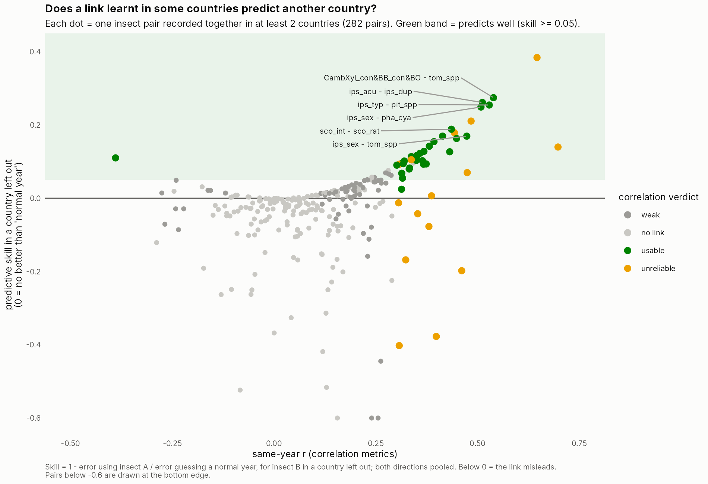
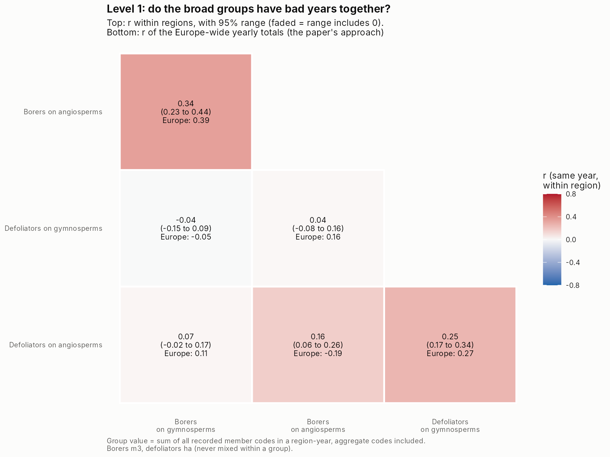

```{r setup}
library(dplyr)
library(targets)
store <- "../_targets"
rd <- function(x) tar_read_raw(x, store = store)
pct <- function(x) paste0(round(x), "%")
v <- rd("cb_verdict"); q5 <- rd("cb_q5"); ps <- rd("cb_pred"); spc <- rd("sp_compare")
u <- filter(v, verdict == "usable")
measurable <- filter(v, verdict != "not enough data")
strong <- c("usable", "promising", "unreliable")
```

## Why these metrics

The thesis rests on one sentence: *damage from different agents tends to fluctuate together, so the existing records carry information about the missing ones.* The correlation metrics test that sentence, pair by pair, for all `r n_distinct(c(v$species_a, v$species_b))` single insects (`r format(nrow(v), big.mark = ",")` pairs). Groups follow Table 1 of the 2025 EU-ForDAM paper (`data/lookup/paper_hierarchy_2025.csv`). Aggregate reporting codes (several insects lumped together, e.g. "borers on pine") are left out here, because comparing a group with its own members says nothing new; they are used in the group-level correlations at the end. Each question below serves one objective:

| Question | Metric | Objective |
|---|---|---|
| 1. Does insect A have bad years when insect B does, in the same region? | same-year r, within region | the premise |
| 2. Does that link hold in every country? | r per country | 1, gap-filling (links learnt in one country fill gaps in another) |
| 3. Is the link regional or Europe-wide? Does one come first? | r of the regional part; A this year vs B next year | 3, drivers and anticipation |
| 4. Do linked insects share feeding type or host tree? | share of strong links within vs between groups | 2, damage across agents and host trees |

**How r is measured.** `value1` only (`value2` is the same damage in another unit). 0 = monitored, no damage; not reported = unknown, left out. Damage on a log(1 + x) scale, each region's series compared with its own average, so a large and a small region count the same. Only region-years where both insects were recorded. The 95% range comes from resampling whole regions 999 times; a link is *sure* when the range excludes 0, *strong* when also r ≥ 0.3. As in the 2025 EU-ForDAM paper, the spruce bark-borer group of Czechia and Germany is counted as *I. typographus*.

## The heatmap: every insect against every other


How to read it: each square is one pair of insects. **Red** = they have bad years together, **blue** = one is high when the other is low; the darker, the stronger. **Strong colour** = a sure link; **faded** = the 95% range includes 0, so it could be chance. **Black boxes** are the usable links (strong and the same in every country checked). Blank = recorded together too rarely to measure. Lines split the paper's four level-1 groups. The red block in the top left is the borers on gymnosperms (bark and wood borers on spruce, pine and fir): that is where most of the shared signal sits.

## The answer in one figure


```{r verdict}
v |> count(verdict, name = "pairs", .drop = FALSE) |>
  mutate(share = pct(100 * pairs / sum(pairs)),
         meaning = c("strong, and holds in every country checked: lean on it",
                     "strong, but only seen in one country: cannot check yet",
                     "strong, but differs between countries: do not transfer",
                     "sure but small (r < 0.3)",
                     "no detectable link",
                     "recorded together too rarely to measure"))
```

## 1 and 2: the links we can use


- **`r nrow(u)` pairs are usable**: strong, and the same direction and similar size in every country where they are recorded together. These are what gap-filling can lean on.
- `r sum(v$verdict == "promising")` more are strong but seen in one country only; they may be real but cannot be checked yet. `r sum(v$verdict == "unreliable")` are strong in one place and not in another.
- Almost all are positive (bad years together). One clear negative: *Pityokteines* spp. with *Pristiphora abietina*.

## 3: regional or Europe-wide, and does one come first?

- `r sum(!u$mostly_europe_wide_part)` of the `r nrow(u)` usable links stay strong in the **r of the regional part** (each value minus the same insect's average in all other regions that year; open circles near the green dots). So most links are **regional**, not just shared European weather. Regional drivers (local drought, storms) are the likely cause and are what the driver data should test (objective 3).
- In `r sum(u$lead != "none clear")` of the `r nrow(u)` usable pairs, one insect's bad year also tends to come before the other's in the next year. This is weaker and less certain than the same-year link, but it is the first hint that damage can be **anticipated** from the records (`outputs/tables/CM_pairs_verdict.csv`, column `lead`).

## 4: feeding type matters, host tree adds little

```{r groups}
measurable |>
  mutate(pair = if_else(group_a == group_b, "same broad group", "different broad groups")) |>
  group_by(pair) |>
  summarise(`measurable pairs` = n(), `strong links` = sum(verdict %in% strong),
            `share strong` = pct(100 * mean(verdict %in% strong)), usable = sum(verdict == "usable"))
```

Level-1 groups of the paper: borers / defoliators on gymnosperms / angiosperms. Pairs in the **same level-1 group** are about five times as likely to be strongly linked. Most usable links are among **borers on gymnosperms** (bark beetles on spruce and pine); most others are borers on gymnosperms with borers on angiosperms (oak *Scolytus* and *Agrilus*), or pine defoliators with each other. A permutation test confirms the group effect (p = `r formatC(q5$p_value[q5$metric == "same_year" & grepl("level 1", q5$pair_class)], format = "f", digits = 3)`); sharing the same level-2 host adds little beyond it.

## 5: does a link predict a country it has never seen?

The correlation tells us two insects move together where both are recorded. Gap-filling needs more: a link learnt in some countries must work in a country that never reported one of the insects. So we test exactly that.

**How.** For each pair (A, B) and each country where both are recorded: hide that country, learn how B follows A in the other countries, then guess B's ups and downs in the hidden country from A alone. Compare with the simplest guess, "a normal year". **Skill** = how much smaller the error is: 0 = no help, 0.1 = 10% smaller error, below 0 = the link learnt elsewhere misleads. Both directions (A → B and B → A) are pooled.



```{r pred}
ps |> count(predictive, name = "pairs") |>
  mutate(meaning = c("skill >= 0.05 and helps in at least 3 of 4 hidden countries",
                     "skill > 0 and helps in at least half",
                     "about as good as guessing a normal year",
                     "skill < -0.05: the link does not transfer and makes guesses worse",
                     "recorded together in fewer than 2 countries"))
```

```{r pred_cross}
pu <- filter(ps, verdict == "usable")
ps |> filter(verdict %in% c("usable", "unreliable")) |> count(verdict, predictive) |>
  tidyr::pivot_wider(names_from = predictive, values_from = n, values_fill = 0)
```

- **The correlation verdicts hold up.** All `r nrow(pu)` usable pairs help predict a country left out: `r sum(pu$predictive == "predicts well")` predict well, `r sum(pu$predictive == "predicts a little")` a little, none mislead. Of the `r sum(ps$verdict == "unreliable")` unreliable pairs, `r sum(ps$verdict == "unreliable" & ps$predictive == "misleads")` make guesses worse, which is exactly why they were flagged.
- **The gain from one partner insect is modest.** For usable pairs the error is typically `r round(100 * median(pu$skill))`% smaller (range `r round(100 * min(pu$skill))`-`r round(100 * max(pu$skill))`%), and still `r round(100 * median(pu$skill_beyond_year))`% in the regional part. The best: *I. acuminatus* with *I. duplicatus*, *I. typographus* with *Pityokteines*, *I. sexdentatus* with *Phaenops cyanea* (about 25%).
- **High correlation is not enough.** *I. typographus* with *Pityogenes chalcographus* has the highest pooled r and a high pooled skill, but the link differs between countries (strong in DE and AT, not in IT or SK), so it is "unreliable".
- **Most pairs cannot be tested** (`r sum(ps$predictive == "cannot test")` of `r nrow(ps)`): they are recorded together in only one country.

For gap-filling this means: one partner insect gives a modest but real gain, so the factor model, which combines all partners at once, is the right tool. The usable links are the ones it can trust across countries.

## Check: does the choice of correlation matter? (Spearman)

Pearson r uses the actual sizes of the ups and downs, so one huge outbreak year can dominate a series. Spearman r uses only the **order** of the years (which year was a region's worst, second worst, ...), so outbreaks cannot dominate. We reran the whole pipeline with within-region ranks instead of values.

- The two agree almost perfectly: correlation between Pearson and Spearman r across all pairs = `r formatC(cor(spc$r_pearson, spc$r_spearman, use = "pair"), format = "f", digits = 2)`; typical difference `r formatC(median(abs(spc$r_pearson - spc$r_spearman), na.rm = TRUE), format = "f", digits = 2)`.
- Usable pairs: `r sum(spc$verdict_pearson == "usable")` with Pearson, `r sum(spc$verdict_spearman == "usable")` with Spearman, `r sum(spc$verdict_pearson == "usable" & spc$verdict_spearman == "usable")` in both. The pairs that switch sit right at the edges (r near 0.3, or consistent in one country check but not the other).
- So the results are **not** driven by a few extreme outbreak years. Pearson stays the main metric; Spearman is the robustness check (`outputs/tables/CM_pearson_vs_spearman.csv`).

## The paper's groups (levels 1 and 2)

Group value in a region-year = sum of all recorded member codes, **aggregates included**. Same metric as above (within region, 95% range from resampling regions), plus the paper's own approach (Pearson r of the Europe-wide yearly totals).




```{r groups_tab}
rd("p_group_cm") |>
  transmute(level, `group A` = species_a, `group B` = species_b, `region-years` = n,
            `r within region` = formatC(same_year, format = "f", digits = 2),
            `95% range` = paste(formatC(same_year_lo, format = "f", digits = 2), "to", formatC(same_year_hi, format = "f", digits = 2)),
            `r Europe totals` = formatC(r_europe_total, format = "f", digits = 2))
```

- Borers on spruce, pine and fir have bad years together; so do spruce and pine defoliators.
- Borers and defoliators do not move together; borers on fir go **against** defoliators on spruce (the group version of the *Pityokteines* x *Pristiphora* link).
- Europe-wide totals give much higher r than within-region series, because a Europe-wide total mixes regional signals with shared bad years; the within-region number is the one that matters for gap-filling.

## What it means for the thesis

1. **The premise holds for a core of insects, not for all.** About `r pct(100 * mean(measurable$verdict %in% strong))` of measurable pairs are strongly linked, mostly within feeding groups. For those insects, the records of one do carry information about the other.
2. **Gap-filling (objective 1)** should lean on the `r nrow(u)` usable links and treat the rest with caution. The factor model does this automatically: it learns the shared patterns from all insects at once.
3. **Drivers and anticipation (objective 3):** most links are regional, not Europe-wide, and some insects lead others by a year. Both point to regional drivers worth testing once the drought and storm data are in.
4. **Limit:** many links can only be seen in one or two countries (mostly DE and CZ). More countries reporting more insects is what would firm this up.

## Files

- One row per pair, plain verdict: `outputs/tables/CM_pairs_verdict.csv`
- Predictive test: `CM_predictive_pairs.csv` (per pair), `CM_predictive_by_country.csv` (per hidden country)
- Full detail (ranges, per-country r): `CM_basic_all_pairs.csv`, `CM_basic_Q4_per_country.csv`, `CM_basic_Q3_lead_effects.csv`
- Groups: `CM_groups_level1_level2.csv`
- Figures: `outputs/figures/CM_heatmap.png`, `CM_verdict.png`, `CM_usable_pairs.png`, `CM_groups_level1.png`, `CM_groups_level2.png`
