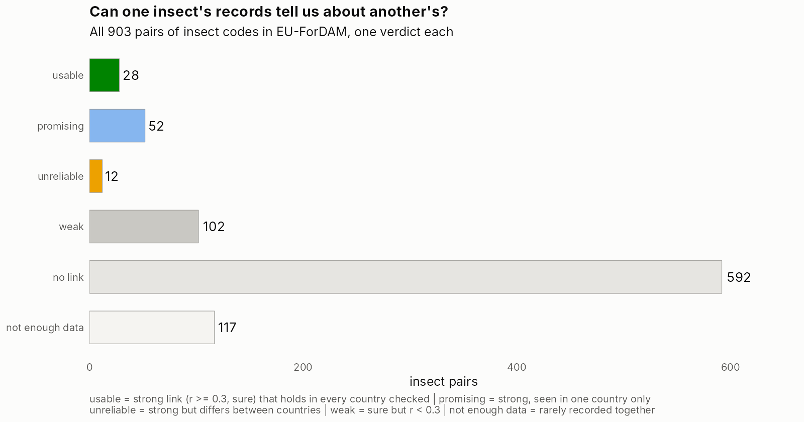
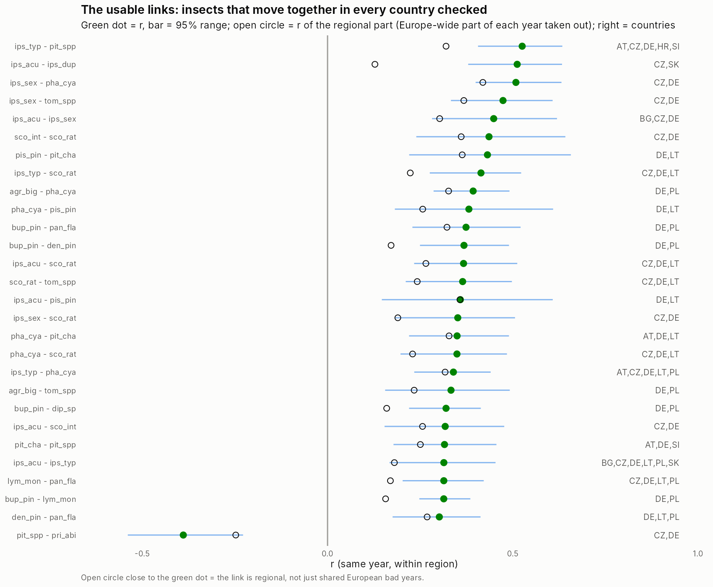

```{r setup}
library(dplyr)
library(targets)
store <- "../_targets"
rd <- function(x) tar_read_raw(x, store = store)
pct <- function(x) paste0(round(x), "%")
v <- rd("cb_verdict"); q5 <- rd("cb_q5")
u <- filter(v, verdict == "usable")
measurable <- filter(v, verdict != "not enough data")
strong <- c("usable", "promising", "unreliable")
```

## Why these metrics

The thesis rests on one sentence: *damage from different agents tends to fluctuate together, so the existing records carry information about the missing ones.* The correlation metrics test that sentence, pair by pair, for all `r n_distinct(c(v$species_a, v$species_b))` insect codes (`r format(nrow(v), big.mark = ",")` pairs). Each question below serves one objective:

| Question | Metric | Objective |
|---|---|---|
| 1. Does insect A have bad years when insect B does, in the same region? | same-year r, within region | the premise |
| 2. Does that link hold in every country? | r per country | 1, gap-filling (links learnt in one country fill gaps in another) |
| 3. Is it regional, or just years bad all over Europe? Does one come first? | r after removing Europe-wide years; A this year vs B next year | 3, drivers and anticipation |
| 4. Do linked insects share feeding type or host tree? | share of strong links within vs between groups | 2, damage across agents and host trees |

**How r is measured.** `value1` only (`value2` is the same damage in another unit). 0 = monitored, no damage; not reported = unknown, left out. Damage on a log(1 + x) scale, each region's series compared with its own average, so a large and a small region count the same. Only region-years where both insects were recorded. The 95% range comes from resampling whole regions 999 times; a link is *sure* when the range excludes 0, *strong* when also r ≥ 0.3. As in Hlásný et al. (2025), the Czech spruce bark-borer group is counted as *I. typographus*.

## The heatmap: every insect against every other


How to read it: each square is one pair of insects. **Red** = they have bad years together, **blue** = one is high when the other is low; the darker, the stronger. Only sure links are coloured. **Black boxes** are the usable links (strong and the same in every country checked). Lines split the four broad groups. The red block in the top left is the bark and wood borers on conifers: that is where most of the shared signal sits.

## The answer in one figure



```{r verdict}
v |> count(verdict, name = "pairs", .drop = FALSE) |>
  mutate(share = pct(100 * pairs / sum(pairs)),
         meaning = c("strong, and holds in every country checked: lean on it",
                     "strong, but only seen in one country: cannot check yet",
                     "strong, but differs between countries: do not transfer",
                     "sure but small (r < 0.3)",
                     "no detectable link",
                     "recorded together too rarely to measure"))
```

## 1 and 2: the links we can use



- **`r nrow(u)` pairs are usable**: strong, and the same direction and similar size in every country where they are recorded together. These are what gap-filling can lean on.
- `r sum(v$verdict == "promising")` more are strong but seen in one country only; they may be real but cannot be checked yet. `r sum(v$verdict == "unreliable")` are strong in one place and not in another.
- Almost all are positive (bad years together). One clear negative: *Pityokteines* spp. with *Pristiphora abietina*.

## 3: regional or Europe-wide, and does one come first?

- `r sum(!u$mostly_europe_wide_years)` of the `r nrow(u)` usable links stay strong after removing years that were bad all over Europe (open circles near the green dots). So most links are **regional**, not just shared European weather. Regional drivers (local drought, storms) are the likely cause and are what the driver data should test (objective 3).
- In `r sum(u$lead != "none clear")` of the `r nrow(u)` usable pairs, one insect's bad year also tends to come before the other's in the next year. This is weaker and less certain than the same-year link, but it is the first hint that damage can be **anticipated** from the records (`outputs/tables/CM_pairs_verdict.csv`, column `lead`).

## 4: feeding type matters, host tree adds little

```{r groups}
measurable |>
  mutate(pair = if_else(group_a == group_b, "same broad group", "different broad groups")) |>
  group_by(pair) |>
  summarise(`measurable pairs` = n(), `strong links` = sum(verdict %in% strong),
            `share strong` = pct(100 * mean(verdict %in% strong)), usable = sum(verdict == "usable"))
```

Broad groups: borers / defoliators on conifers / broadleaves. Pairs in the **same broad group** are about four times as likely to be strongly linked. Most usable links are among **borers on conifers** (bark beetles on spruce and pine); most others are borers on conifers with borers on broadleaves, or defoliators of pine with each other. A permutation test confirms the group effect (p = `r formatC(q5$p_value[q5$metric == "same_year" & grepl("level 1", q5$pair_class)], format = "f", digits = 3)`); sharing the same host tree adds nothing beyond it.

## What it means for the thesis

1. **The premise holds for a core of insects, not for all.** About `r pct(100 * mean(measurable$verdict %in% strong))` of measurable pairs are strongly linked, mostly within feeding groups. For those insects, the records of one do carry information about the other.
2. **Gap-filling (objective 1)** should lean on the `r nrow(u)` usable links and treat the rest with caution. The factor model does this automatically: it learns the shared patterns from all insects at once.
3. **Drivers and anticipation (objective 3):** most links are regional, not Europe-wide, and some insects lead others by a year. Both point to regional drivers worth testing once the drought and storm data are in.
4. **Limit:** many links can only be seen in one or two countries (mostly DE and CZ). More countries reporting more insects is what would firm this up.

## Files

- One row per pair, plain verdict: `outputs/tables/CM_pairs_verdict.csv`
- Full detail (ranges, per-country r): `CM_basic_all_pairs.csv`, `CM_basic_Q4_per_country.csv`, `CM_basic_Q3_lead_effects.csv`
- Figures: `outputs/figures/CM_heatmap.png`, `CM_verdict.png`, `CM_usable_pairs.png`
