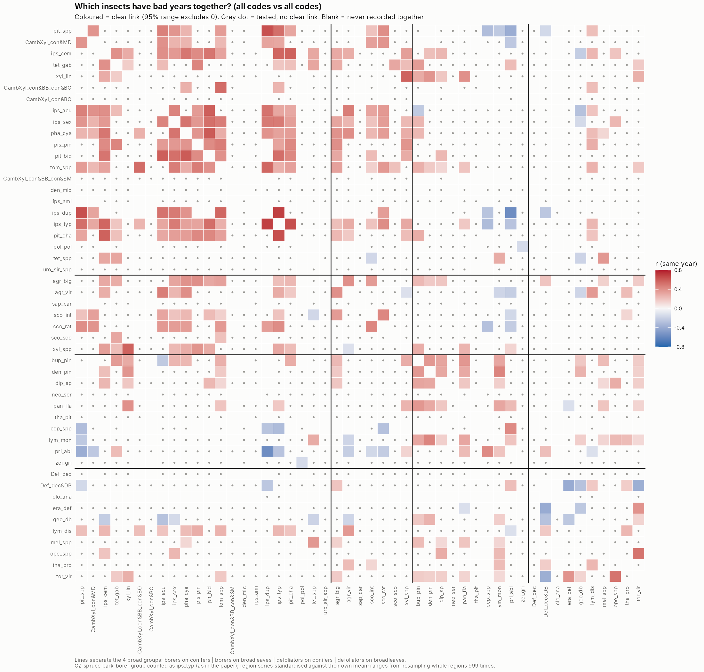
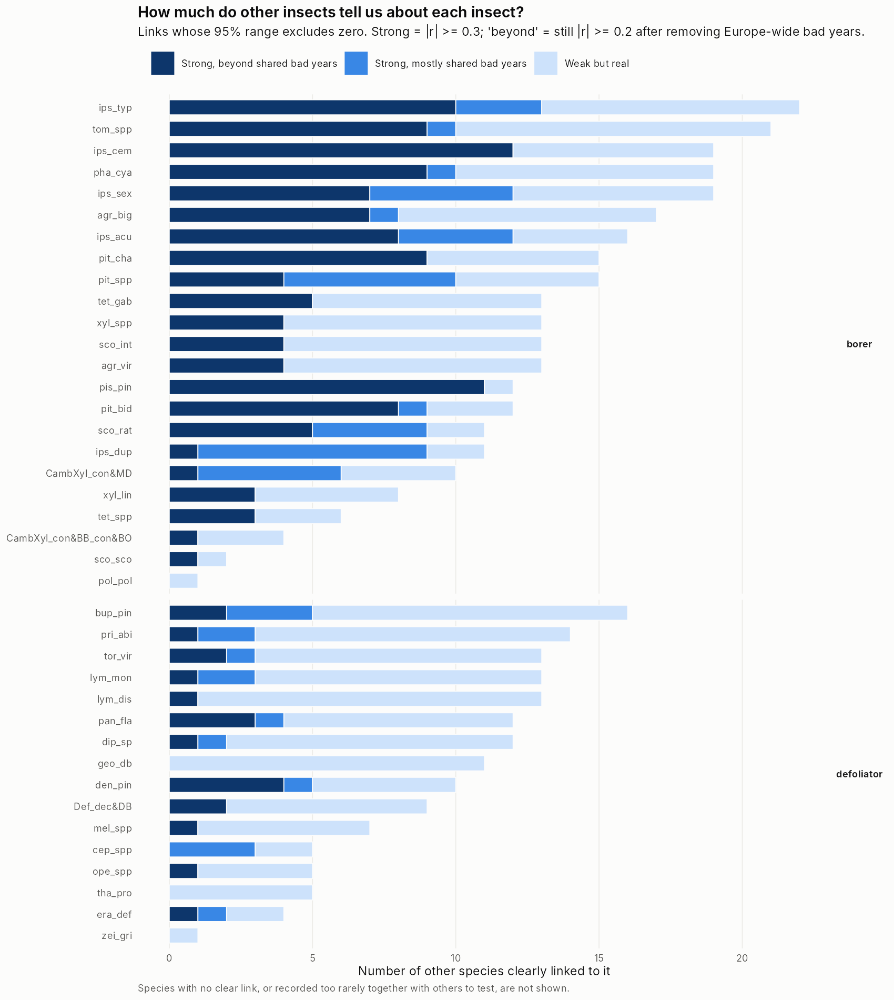
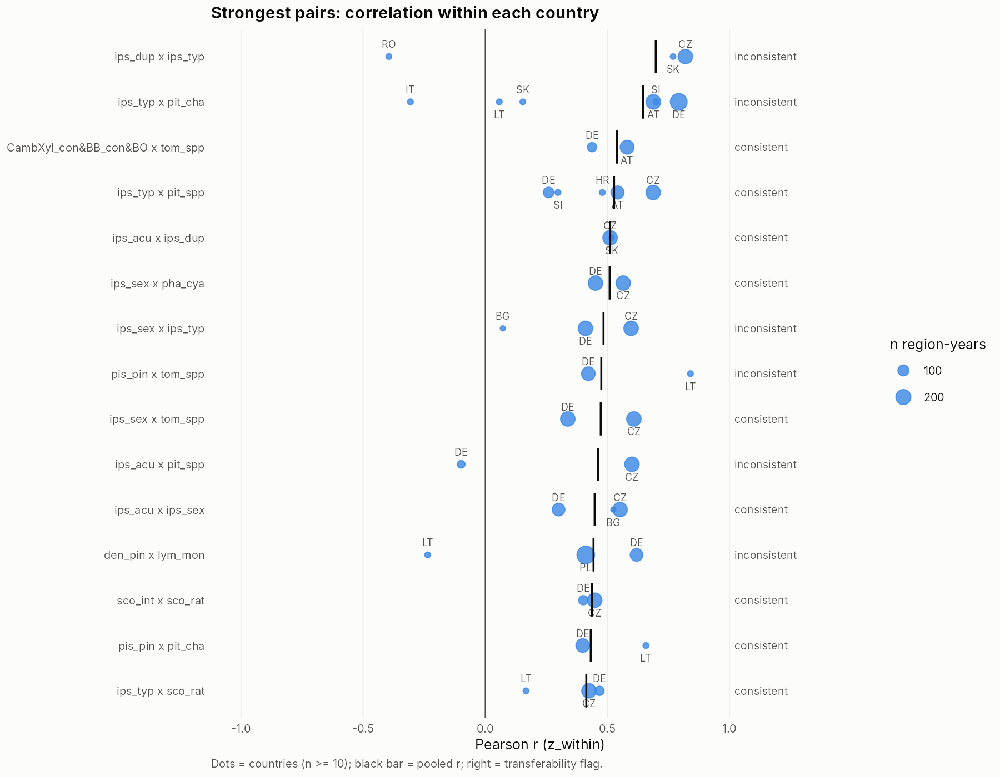

```{r setup}
library(dplyr)
library(targets)
store <- "../_targets"
rd <- function(x) tar_read_raw(x, store = store)
f2 <- function(x) formatC(x, format = "f", digits = 2)
pct <- function(x) paste0(round(x), "%")
t <- rd("cb_table"); info <- rd("cb_info"); lags <- rd("cb_lags"); q5 <- rd("cb_q5")
strong <- c("strong, beyond shared bad years", "strong, mostly shared bad years")
```

## Why

The thesis rests on one premise: *damage from different agents tends to fluctuate together, so the existing records carry information about the missing ones.* This section tests that premise directly, for every pair of insect codes in EU-ForDAM.

## How

- **Pairs:** all `r n_distinct(c(t$species_a, t$species_b))` insect codes (species, genus codes and aggregate groups), `r format(nrow(t), big.mark = ",")` pairs. As in Hlasny et al. (2025), the Czech spruce bark-borer group is counted as *I. typographus*.
- **Data:** `value1` (`value2` is the same damage in another unit). 0 = monitored, no damage; not reported = unknown, never treated as 0. Only region-years where both codes are recorded.
- **Scale:** log(1 + damage), each region's series measured against its own mean, so large and small regions are comparable.
- **Measure:** Pearson r (−1 = opposite, 0 = no link, +1 = always together), with a 95% range from resampling whole regions 999 times. A link is **clear** when the range excludes 0.

Five questions per pair:

| | Question | Metric |
|---|---|---|
| Q1 | Do they have bad years together? | same-year r |
| Q2 | Still linked after removing Europe-wide bad years? | r after removing each code's Europe-wide yearly mean |
| Q3 | Does one come first? | A in year t vs B in year t+1, beyond B's own persistence |
| Q4 | Does the link hold in each country? | r per country; consistent = same sign, similar size, no country flips it |
| Q5 | Do linked insects share a broad group or host tree? | mean r by shared group vs 999 random relabellings |

## Q1 and Q2: which insects fluctuate together?



```{r q12}
t |> count(link, name = "pairs") |>
  mutate(link = factor(link, c(strong, "weak but real", "no clear link", "not enough data"))) |>
  arrange(link) |> mutate(share = pct(100 * pairs / sum(pairs)))
```

- `r sum(!is.na(t$Q1_same_year_r))` pairs can be measured; `r sum(t$link %in% c(strong, "weak but real"))` have a clear link.
- `r sum(t$link == strong[1])` pairs are strongly linked **even after removing Europe-wide bad years** (Q2): their link is not just shared weather.
- The links concentrate in the **borers on conifers** block (top left of the matrix). Borers on broadleaves also link to them; defoliators link mainly among themselves; borers and defoliators rarely link.
- A few clear **negative** links (blue): e.g. *Pristiphora abietina* with *I. duplicatus* (one high when the other is low).



Most connected insects (number of strong links beyond shared bad years): `r paste0(head(info$species, 6), " (", head(info$strong_links, 6), ")", collapse = ", ")`.

## Q3: does one come first?

```{r q3}
nl <- nrow(lags); ns <- sum(lags$sure)
```

Of `r format(nl, big.mark = ",")` directional tests (A this year, B next year), `r ns` are clear, about `r round(ns / (0.05 * nl), 1)` times the `r round(0.05 * nl)` expected by chance. Lead effects exist but are weaker and less certain than same-year links; most involve few regions (5-10). Strongest: `r paste0(head(lags$leader[lags$sure], 3), " then ", head(lags$follower[lags$sure], 3), collapse = "; ")`. Full list: `outputs/tables/CM_basic_Q3_lead_effects.csv`.

## Q4: does a link hold across countries?



```{r q4}
s <- filter(t, link %in% strong)
s |> count(Q4_holds_across_countries, name = "strong pairs") |> mutate(share = pct(100 * `strong pairs` / sum(`strong pairs`)))
```

Of the `r nrow(s)` strong pairs, `r sum(s$Q4_holds_across_countries == "consistent")` hold consistently in every country where they can be checked, `r sum(s$Q4_holds_across_countries == "inconsistent")` differ between countries, and `r sum(s$Q4_holds_across_countries == "insufficient data")` are recorded together in fewer than two countries, so this cannot be checked. This matters for gap-filling, which uses links learnt in one country to fill another. Example of a consistent link: *I. typographus* with *Pityokteines* spp. (AT, CZ, DE, HR, SI); example of an inconsistent one: *I. typographus* with *Pityogenes chalcographus* (strong in DE, AT, SI; near zero or negative in LT, SK, IT).

## Q5: do the links follow host trees and feeding type?

```{r q5}
q5 |> mutate(metric = recode(metric, same_year = "same year", beyond_year = "beyond shared bad years"),
             across(c(mean_r, mean_r_random), f2), p_value = formatC(p_value, format = "f", digits = 3)) |>
  select(metric, `pairs that share` = pair_class, n_pairs, mean_r, `mean r, random labels` = mean_r_random, p_value)
```

Insects in the **same broad group** (borers / defoliators on conifers / broadleaves) have bad years together more than chance (p = `r formatC(q5$p_value[q5$metric == "same_year" & grepl("level 1", q5$pair_class)], format = "f", digits = 3)`). Sharing the **same host tree** adds nothing beyond that. After removing Europe-wide bad years, no grouping clearly beats chance.

## What it means for the thesis

1. **The premise holds, partly.** About a fifth of measurable pairs are clearly linked, strongest among bark and wood borers on conifers. These insects carry information about each other; most other pairs do not.
2. **Most strong links are more than shared bad years** (Q1 vs Q2): `r sum(t$link == strong[1])` of `r sum(t$link %in% strong)` strong pairs stay linked after removing Europe-wide bad years; the other `r sum(t$link == strong[2])` are mainly years that were bad everywhere. Shared drivers (drought, storms) acting regionally are a likely source; adding those data later should explain part of the links (objective 3).
3. **Transfer between countries is the limiting factor.** Many strong links cannot be checked in a second country; where they can, `r round(100 * sum(s$Q4_holds_across_countries == 'consistent') / sum(s$Q4_holds_across_countries != 'insufficient data'))`% hold. Gap-filling should rely most on consistent links (objective 1).
4. **Feeding type matters more than host tree:** borers move with borers, defoliators with defoliators.

## Files

- All pairs, all five questions: `outputs/tables/CM_basic_all_pairs.csv`
- Per insect: `CM_basic_per_insect.csv`; lead effects: `CM_basic_Q3_lead_effects.csv`; per country: `CM_basic_Q4_per_country.csv`; structure test: `CM_basic_Q5_structure_test.csv`
- Figures: `outputs/figures/CM_basic_1_matrix.png`, `CM_basic_2_links_per_insect.png`, `CM_basic_3_across_countries.png`
