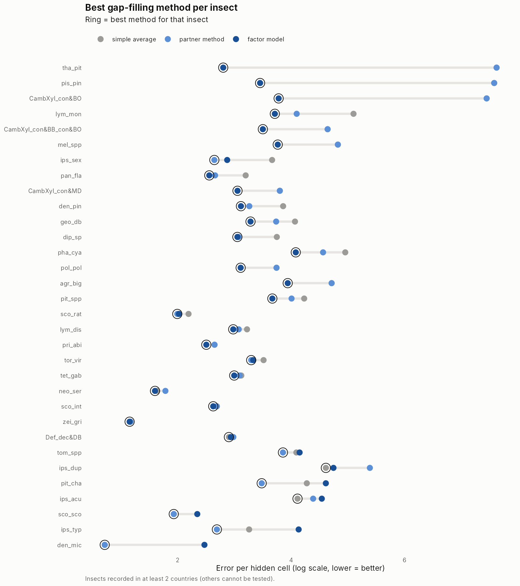
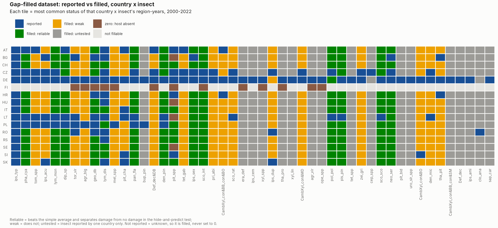
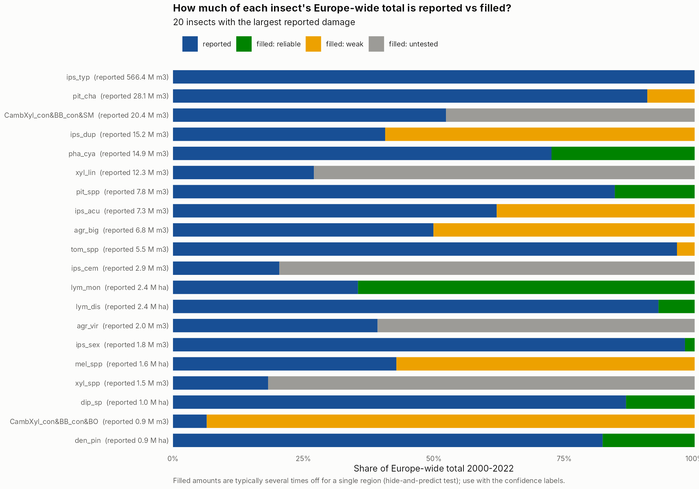

```{r setup}
library(dplyr)
library(targets)
store <- "../_targets"
rd <- function(x) tar_read_raw(x, store = store)
f2 <- function(x) formatC(x, format = "f", digits = 2)
pct <- function(x) paste0(round(x), "%")
big <- function(x) format(x, big.mark = ",")
gs <- rd("gf_scores"); ov <- gs$overall; bys <- gs$by_species
v2 <- rd("v2_scores"); gd <- rd("gf_data"); gt <- rd("gf_totals")
fm <- ov |> filter(method == "factor model + forest area (amount only)")
sa <- ov |> filter(method == "simple average")
```

## The question

Most gaps in EU-ForDAM are insects a country never reported. Following the thesis premise, *the existing records carry information about the missing ones*, we estimate those gaps from the insects that **were** reported. Rules: 0 = monitored, no damage (kept); not reported = unknown (estimated, never set to 0); host tree absent from the region = 0 (forest table of Hlasny et al. 2025); value1 only; the Czech spruce bark-borer group counted as *I. typographus* as in the paper.

## How methods were tested

Real reported values were **hidden** in whole country x insect blocks (exactly the shape of a real gap: a country without any record of an insect), predicted from the rest, and compared with the truth: `r big(ov$n_cells[1])` hidden cells, 10 rounds. Insects reported by only one country cannot be tested this way.

| Method | What it does |
|---|---|
| Simple average | the insect's mean in that year (the yardstick) |
| Partner method | borrows from insects linked to it (correlation metrics) recorded in the same region-year |
| Factor model | latent factor model using all insects at once, in two parts: *any damage?* x *how much?*; each insect's level pulled towards its broad group |
| + forest area | the factor model plus host-forest area per region (NUTS forest table) |


```{r overall}
ov |> transmute(method, `error per cell (log)` = f2(error_log), `damage vs no damage (AUC)` = f2(damage_vs_none_auc),
                `totals within 2x` = pct(100 * totals_within_2x), `typical total error (x off)` = f2(typical_total_error_x))
```

**Result.** Methods that use the other insects beat the simple average, which supports the thesis premise. The factor model is clearly best: it separates damage from no damage much better (AUC `r f2(fm$damage_vs_none_auc)` vs `r f2(sa$damage_vs_none_auc)`) and gets regional totals far closer (typically `r f2(fm$typical_total_error_x)`x off vs `r round(sa$typical_total_error_x)`x), because it learns each region's overall level from all its other insects. Forest area adds only a little, and only when used for the amounts.



The best method differs by insect; the partner method wins for several conifer bark beetles with strong, consistent partners.

## Attempts to improve further

```{r v2}
v2 |> transmute(method, `error per cell (log)` = f2(error_log), `damage vs no damage (AUC)` = f2(damage_vs_none_auc),
                `totals within 2x` = pct(100 * totals_within_2x), `typical total error (x off)` = f2(typical_total_error_x))
```

Memory (the region's other insects last year), neighbouring regions (NUTS positions), a country reporting effect and a Tweedie distribution were added as a second stage. None beat the factor model: memory and reporting level are already captured by it through the other insects; neighbours carry a little extra information, but adding them as a second stage disturbs the level and damages totals. This suggests the model is close to what the damage records alone can predict; further gains likely need external drivers (drought/VPD, storms) and spatial structure inside the model.

## The gap-filled dataset (v1)

Method: factor model + forest area for amounts; partner method for the insects where it tested best.

```{r cells}
gd |> count(value_type, name = "cells") |> mutate(share = pct(100 * cells / sum(cells))) |> arrange(desc(cells))
```

```{r conf}
gd |> filter(value_type == "filled") |> count(confidence, name = "filled cells") |>
  left_join(gd |> filter(value_type == "filled") |> distinct(species, confidence) |> count(confidence, name = "insects"), by = "confidence")
```

**Confidence** of a filled value: *reliable* = in the test, its method beats the simple average for that insect and separates damage from no damage (AUC >= 0.7); *weak* = tested but not both; *untested* = insect reported by one country only.





```{r totals}
gt |> group_by(species, unit) |>
  summarise(across(c(reported, filled_reliable, filled_weak, filled_untested), sum), .groups = "drop") |>
  slice_max(reported, n = 12) |>
  transmute(insect = species, unit, `reported (M)` = f2(reported / 1e6), `+ reliable fill (M)` = f2(filled_reliable / 1e6),
            `+ weak fill (M)` = f2(filled_weak / 1e6), `+ untested fill (M)` = f2(filled_untested / 1e6))
```

## How to read it

- Reported values are untouched; every filled value carries its method and confidence.
- Filled values are good for **whether and when** damage occurred, rough for **how much** (a single regional total is typically several times off).
- Europe-wide totals: use reported + reliable fills; treat weak and untested fills as indications only.

## Files

- Dataset: `data/processed/eufordam_gapfilled_v1.csv` (local only, not in the public repository)
- Tables: `outputs/tables/GF_methods_overall.csv`, `GF_methods_by_insect.csv`, `GF_v2_extras_scores.csv`, `GF_dataset_summary.csv`, `GF_europe_totals_reported_plus_filled.csv`
