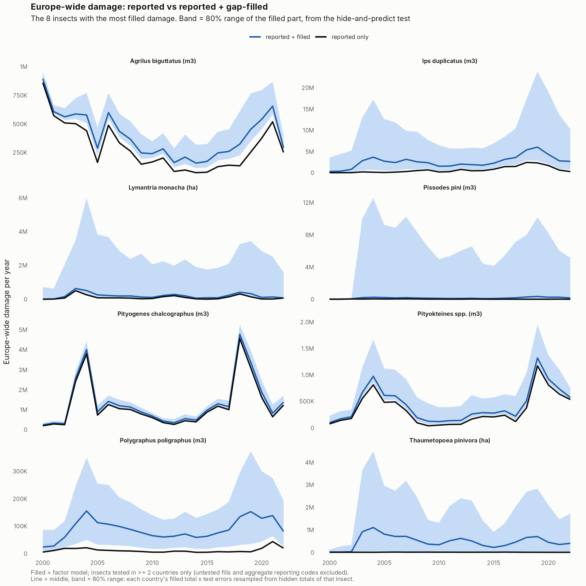

```{r setup}
library(dplyr)
tb <- function(f) read.csv(file.path("../outputs/tables", f), check.names = FALSE)
f2 <- function(x) formatC(x, format = "f", digits = 2)
pct <- function(x) paste0(round(100 * x), "%")
big <- function(x) format(signif(x, 2), big.mark = ",", scientific = FALSE)
```

## The question

The thesis rests on one idea: **damage from different insects tends to rise and fall together, so the records we have carry information about the ones that are missing.** Everything below tests that idea and then uses it.

| Step | Question | Thesis objective |
|---|---|---|
| 1. Species ranking | Which insects cause damage in the most regions? | 2 (damage across agents) |
| 2. Correlation metrics | Do insects really rise and fall together? | the premise; 3 (patterns) |
| 3. Gap-filling | Can we use that to fill the missing records? | 1 (harmonise records), then 2 (Europe-wide totals) |

**Data and rules used throughout.** EU-ForDAM, 49 insect codes, 16 countries, 77 regions (NUTS units), 2000-2022. `value1` only (`value2` is the same damage in another unit). 0 = monitored, no damage; not reported = unknown (never treated as 0). The Czech spruce bark-borer group is counted as *Ips typographus*, as in the 2025 EU-ForDAM paper.

---

## 1. Species-NUTS occurrence ranking


- *Ips typographus* is everywhere: damage in **72 of 77** regions, all 16 countries.
- Next: *Phaenops cyanea* (44 regions), *Tomicus* spp. (42), *Ips acuminatus* (34), *Lymantria monacha* (32).
- Most codes are local: half cause damage in 15 regions or fewer.

---

## 2. Correlation metrics: do insects rise and fall together?

**How.** For every pair of insects (1,176 pairs), in the same region and year: does one have a bad year when the other does? Each region is compared with its own normal (so big and small regions count the same). A link is **sure** if it survives resampling whole regions 999 times, and **strong** if r is at least 0.3.


### The heatmap


Red = bad years together. Strong colour = sure link; faded = could be chance; black box = usable. The red block top left is the bark and wood borers on conifers.

### One verdict per pair


**30 usable pairs**: strong and the same in every country where they can be checked. About 10% of measurable pairs are strongly linked.

### The 30 usable pairs


### Key findings


1. **The premise holds for a core of insects**, mainly conifer bark beetles and pine defoliators.
2. **Links are regional**: 23 of the 30 stay strong after removing years that were bad all over Europe.
3. **Feeding type matters, host tree adds little**: pairs in the same broad group are strongly linked 23% of the time vs 5% across groups.
4. **Checks**: Spearman (rank) correlation gives the same answer (agreement 0.97); hiding one country at a time, all 30 usable links help predict the hidden country (about 10-25% less error).

---

## 3. Gap-filling with a latent factor model

### How it works (plain words)

Each empty box (region x year x insect) gets two questions, multiplied together:

1. **Was there any damage?** (a chance)
2. **If yes, how much?** (an amount per 1,000 ha of host forest, scaled by the region's forest)

The model learns a few hidden "scores" for each region-year (e.g. *was this a bad bark-beetle year here?*) from the insects that **were** recorded there, and each insect's sensitivity to those scores from where it **was** recorded. That is the thesis idea written as a model.

**Rules:** reported values kept; host tree absent = 0; insect outside its range = 0 (draft rule, below); nothing recorded in a region-year = not filled; aggregate reporting codes not filled.

### Does it work? The hide-and-predict test

Real values were hidden (a whole country's records for one insect), predicted, and compared with the truth: about 17,000 hidden cells, 10 rounds.


The factor model clearly beats the simple average: it tells damage from no damage much better (AUC 0.76 vs 0.64) and gets regional totals far closer (typically 4.5x off vs 46x).

### A better version of the model (M2)

```{r m12}
tb("GF_M0_M1_M2_comparison.csv") |>
  transmute(Version = model, `Error (lower = better)` = f2(error_log), `Damage vs none (AUC)` = f2(damage_vs_none_auc),
            `Totals within 2x` = pct(totals_within_2x), `Typical total off by` = paste0(f2(typical_total_error_x), "x"),
            `Usable pairs the model reproduces` = paste(usable_linked, "of", usable_n))
```

**M2** (region and year effects separated, 3 hidden factors, insects pulled towards their feeding group) is the best on every score and now reproduces **23 of the 30** usable pairs instead of 15. It is the model used for the current filled dataset (v3).

### Where insects can live: the range rule

The model first filled insects wherever their tree grows, inventing damage outside their natural range. A draft rule now fills an insect only in countries that report it or border one that does. This removed about two thirds of the invented damage (filled m3 from 201 to 63 million; ha from 46 to 16 million). The draft table is in `outputs/tables/GF2_range_draft_for_correction.xlsx` for expert correction.

### Europe-wide totals (dataset v3)



Black = reported only; blue = reported + filled; band = 80% range from the test (it catches the truth about 75% of the time). For most insects the filled part is a modest top-up (0.1-1x reported) that follows the reported ups and downs.

---

## Where we stand

| | Status |
|---|---|
| Species ranking | ✅ done |
| Correlation metrics | ✅ done: premise holds for a core group; 30 usable pairs |
| Gap-filling method | ✅ works and is tested; clearly better than simple averages |
| Filled dataset | ✅ v3 with ranges and confidence labels |
| Europe-wide totals | ⚠️ nearly: a few insects still too high until the range list is checked |

**Open points**

- **Range list**: needs expert checks, especially `tha_pit` (*T. pityocampa* or *T. pinivora*? If *T. pityocampa*, its filled damage drops from about 11 million to 70,000 ha), *Pissodes pini*, *Polygraphus poligraphus* and *Ips duplicatus*.
- **Amounts** are still rough (a regional total is typically about 4x off). Adding drought and storm data is the main expected improvement, and it also answers objective 3 (drivers and anticipation).

## Files

- Reports: `reports/correlation_metrics.html`, `reports/gapfilling.html`
- Figures: `outputs/figures/` (CM_* = correlation metrics, GF* = gap-filling)
- Tables: `outputs/tables/` (e.g. `CM_pairs_verdict.csv`, `GF3_europe_totals_with_ranges.csv`, `GF2_range_draft_for_correction.xlsx`)
- Filled dataset (local only): `data/processed/eufordam_gapfilled_v3.csv`
