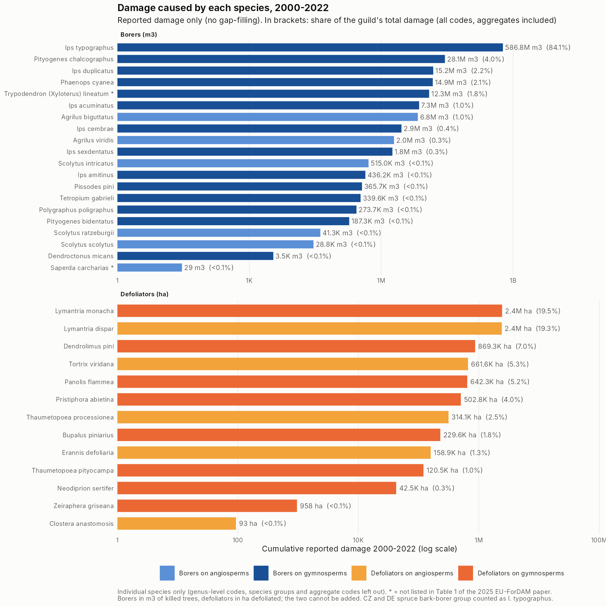
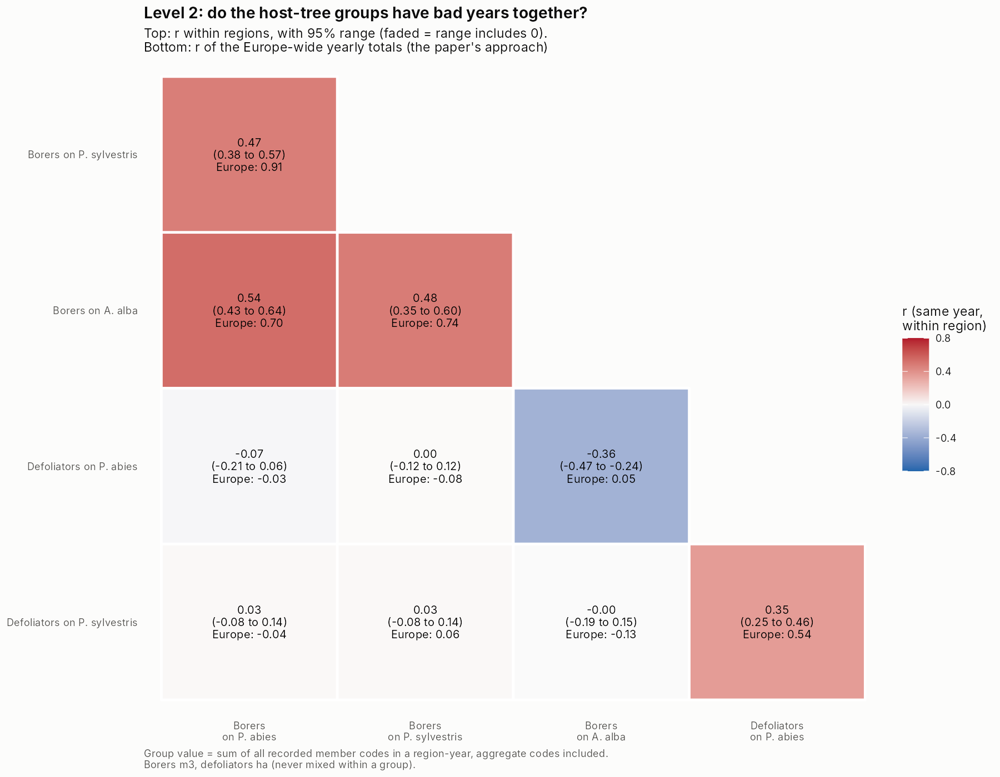
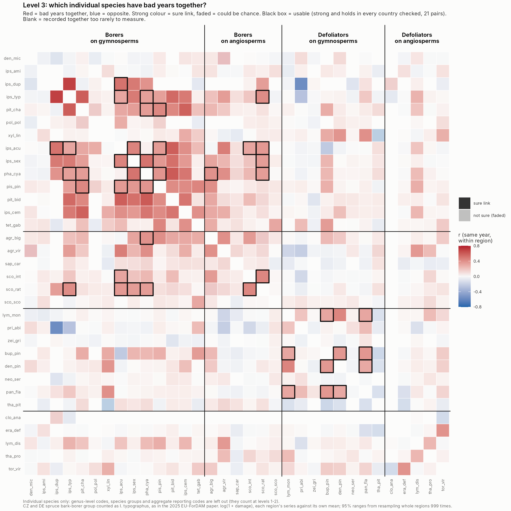
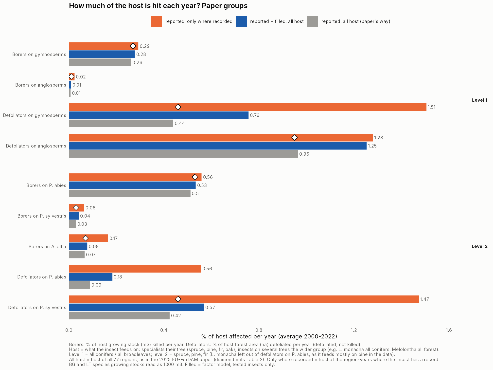
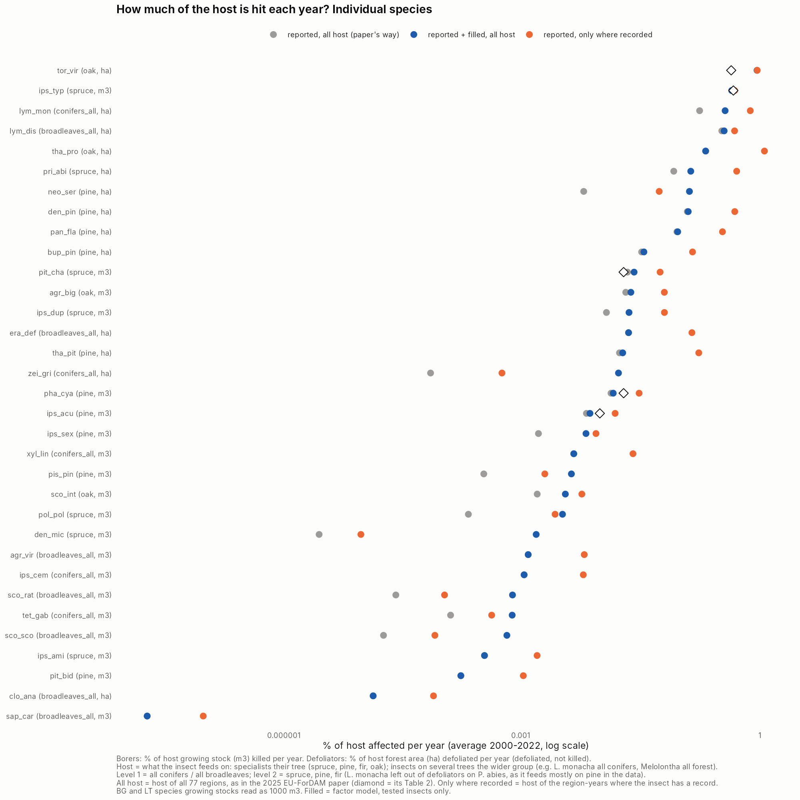
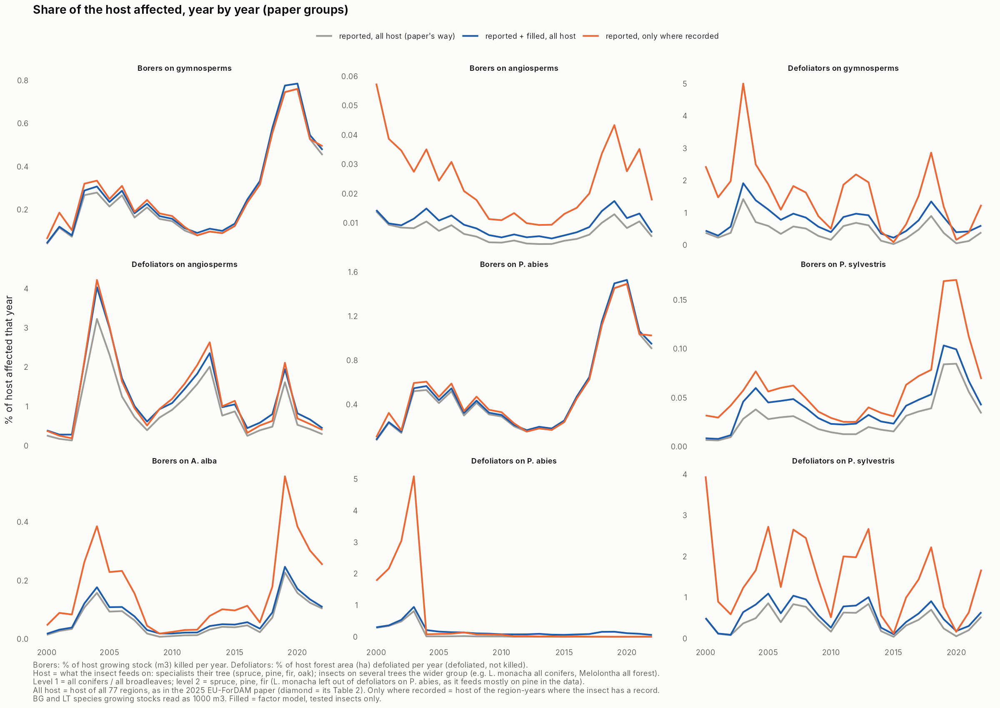

```{r setup}
library(dplyr)
tb <- function(f) read.csv(file.path("../outputs/tables", f), check.names = FALSE)
f2 <- function(x) formatC(x, format = "f", digits = 2)
pct <- function(x) paste0(round(100 * x), "%")
big <- function(x) format(signif(x, 2), big.mark = ",", scientific = FALSE)
```

## The question

The thesis rests on one idea: **damage from different insects tends to rise and fall together, so the records we have carry information about the ones that are missing.** Everything below tests that idea and then uses it.

| Step | Question | Thesis objective |
|---|---|---|
| 1. Species ranking | Which insects cause damage in the most regions? | 2 (damage across agents) |
| 2. Correlation metrics | Do insects really rise and fall together? | the premise; 3 (patterns) |
| 3. Gap-filling | Can we use that to fill the missing records? | 1 (harmonise records), then 2 (Europe-wide totals) |

**Data and rules used throughout.** EU-ForDAM, 16 countries, 77 regions (NUTS units), 2000-2022. `value1` only (`value2` is the same damage in another unit). 0 = monitored, no damage; not reported = unknown (never treated as 0).

**Groups follow the 2025 EU-ForDAM paper (Table 1).**

| Level | What | Groups |
|---|---|---|
| 1 | feeding guild x host type | Borers / Defoliators on gymnosperms / angiosperms |
| 2 | gymnosperm host | Borers on *P. abies*, *P. sylvestris*, *A. alba*; Defoliators on *P. abies*, *P. sylvestris* |
| 3 | single insects | 43 codes (species, genera, and the species group "Geometridae on oaks") |

Some codes are **aggregates**: several insects reported together (e.g. `CambXyl_con&BO` = "borers on pine"). As in the paper, they count **only in the group totals** (levels 1-2). They are never ranked, correlated or gap-filled as if they were one insect. The spruce bark-borer group (`CambXyl_con&BB_con&SM`, Czechia and Germany) is mostly *Ips typographus* and is counted as *I. typographus*, again as in the paper. `tha_pit` is *Thaumetopoea pityocampa* (the paper's name). The code-to-group table is `data/lookup/paper_hierarchy_2025.csv`.

**Check against the paper.** Our cumulative totals reproduce the paper's Table 2 closely: *I. typographus* to 0.01%, Borers on angiosperms exactly, *P. chalcographus* exactly, Borers on *P. abies* within 2% (the paper's total appears not to include *Trypodendron lineatum*, which is in our data and counted here). The rest are within 0-9% (defoliators slightly higher in our file, probably later data corrections; the paper used 15 countries). Table: `outputs/tables/CHECK_totals_vs_paper_table2.csv`.

---

## 1. Species-NUTS occurrence ranking

Three graphs, one per level of the 2025 paper.


How much damage each species caused (reported, 2000-2022):



- **Borers:** *Ips typographus* alone caused 84% of all borer damage (587 million m3), as in the paper (85.8%). Next: *Pityogenes chalcographus* (4%), *Ips duplicatus* (2.2%), *Phaenops cyanea* (2.1%).
- **Defoliators** are much more even: *Lymantria monacha* and *L. dispar* about 19% each, then *Dendrolimus pini* (7%), *Tortrix viridana* and *Panolis flammea* (5% each).
- Being widespread is not the same as causing much damage: *Ips acuminatus* is in 34 regions but causes only 1% of borer damage; *Ips duplicatus* is in 10 regions and causes 2.2%.

- **Level 1:** Borers on gymnosperms cause damage in **73 of 77** regions; defoliators on angiosperms are next (51).
- **Level 2, every host tree:** borers on spruce (*P. abies*) lead with 72 regions and 644 million m3, then defoliators on oak (*Quercus*, 51), borers on pine (49), defoliators on pine (37), borers on oak (36), defoliators on spruce (35), borers on larch (26) and borers on fir (21). Birch, elm and poplar/willow insects are rare (1-12 regions). The paper's own level 2 covers spruce, pine and fir only; the other host trees come from the data file's host-tree column.
- **Aggregates are inside the groups now**, not ranked as insects. They are a small part of each group: 0.3% of Borers on gymnosperms, 5% of Borers on *P. sylvestris*, 6% of Defoliators on angiosperms.
- **Level 3, individual species** (33 codes that name one species; genus-level codes such as *Tomicus* spp. and the aggregates count only in the groups): *Ips typographus* is everywhere (72 regions, all 16 countries). Next: *Phaenops cyanea* (44), *Ips acuminatus* (34), *Lymantria monacha* (32), *Tortrix viridana* (30). Most species are local: half cause damage in 11 regions or fewer.

---

## 2. Correlation metrics: do insects rise and fall together?

**How.** For every pair of single insects (43 insects, 903 pairs; aggregates left out), in the same region and year: does one have a bad year when the other does? Each region is compared with its own normal (so big and small regions count the same). A link is **sure** if it survives resampling whole regions 999 times, and **strong** if r is at least 0.3.


### The heatmap


Red = bad years together. Strong colour = sure link; faded = could be chance; black box = usable. The red block top left is the bark and wood borers on conifers.

### One verdict per pair


**28 usable pairs**: strong and the same in every country where they can be checked. About 12% of measurable pairs are strongly linked. (Before the retool there were 30; the two that dropped out were aggregate x insect pairs, which compared a group with its own members.)

### The 28 usable pairs


### Key findings


1. **The premise holds for a core of insects**, mainly bark beetles on spruce and pine and pine defoliators.
2. **Links are mostly regional**: 21 of the 28 are still clear when the Europe-wide part of each year (the part all regions share) is separated out. The rest are mostly carried by years that were bad everywhere.
3. **The paper's level-1 groups matter**: pairs in the same level-1 group are strongly linked 28% of the time vs 6% across groups (permutation test p = 0.001).
4. **Checks**: Spearman (rank) correlation gives the same answer (agreement 0.97); hiding one country at a time, all 28 usable links help predict the hidden country (typically 11% less error).

### The heatmaps at the paper's three levels






Level 3 shows individual species only (33 species, 528 pairs, 21 of them usable). The full verdicts above also include genus-level codes such as *Tomicus* spp. (43 insects, 28 usable pairs).

Here the group series include the aggregates. Bark borers on spruce, pine and fir have bad years together (r 0.47-0.54 within regions; 0.70-0.91 for the Europe-wide totals, the paper's way). Spruce and pine defoliators go together (0.35). Borers and defoliators do **not** move together, and fir borers go **against** spruce defoliators (-0.36). Table: `CM_groups_level1_level2.csv`.

---

## 3. Gap-filling with a latent factor model

### How it works (plain words)

Each empty box (region x year x insect) gets two questions, multiplied together:

1. **Was there any damage?** (a chance)
2. **If yes, how much?** (an amount per 1,000 ha of host forest, scaled by the region's forest)

The model learns a few hidden "scores" for each region-year (e.g. *was this a bad bark-beetle year here?*) from the insects that **were** recorded there, and each insect's sensitivity to those scores from where it **was** recorded. That is the thesis idea written as a model.

**Rules:** reported values kept; host tree absent = 0; insect outside its range = 0 (draft rule, below); nothing recorded in a region-year = not filled. Aggregate codes help the model learn but are **never filled**, and the tests are scored on single insects only.

### Does it work? The hide-and-predict test

Real values were hidden (a whole country's records for one insect), predicted, and compared with the truth: about 17,000 hidden cells, 10 rounds.


The factor model clearly beats the simple average: it tells damage from no damage much better and gets regional totals far closer.

### A better version of the model (M2)

```{r m12}
tb("GF_M0_M1_M2_comparison.csv") |>
  transmute(Version = model, `Error (lower = better)` = f2(error_log), `Damage vs none (AUC)` = f2(damage_vs_none_auc),
            `Totals within 2x` = pct(totals_within_2x), `Typical total off by` = paste0(f2(typical_total_error_x), "x"),
            `Usable pairs the model reproduces` = paste(usable_linked, "of", usable_n))
```

**M2** (region and year effects separated, 3 hidden factors, insects pulled towards their level-1 group) is the best on every score (AUC 0.79; a hidden regional total typically 4.3x off) and reproduces **22 of the 28** usable pairs instead of 13. It is the model used for the current filled dataset (v3).

### Where insects can live: the range rule

The model first filled insects wherever their tree grows, inventing damage outside their natural range. A draft rule now fills an insect only in countries that report it or border one that does; *T. pityocampa* only in BG, CH, HR, IT and SI (its southern range). The draft table is in `outputs/tables/GF2_range_draft_for_correction.xlsx` for expert correction.

### Europe-wide totals by the paper's groups (dataset v3)


```{r gtot}
tb("GF3_cumulative_totals_by_paper_group.csv") |>
  transmute(Level = sub("level", "", level), Group = group, Unit = unit,
            `Reported 2000-2022` = big(reported), `Filled` = big(filled), `Filled vs reported` = pct(filled_vs_reported))
```

Black = reported only (aggregates included); blue = reported + filled; band = 80% range from the test (it catches the truth about 74% of the time). For borers the filled part is a small top-up (+6% for all borers on gymnosperms, +4% on spruce): the big outbreaks are already reported. For defoliators it is larger (+30-110%), and the ranges are very wide, because defoliator records are patchier and harder to predict.

Per insect: `outputs/figures/GF3_europe_totals_with_ranges.png`.

---

## 4. How much of the host is hit each year?

For **borers**: % of the host's growing stock (m3) killed per year. For **defoliators**: % of the host's forest area (ha) defoliated per year (defoliated, not necessarily killed). Host values come from the NUTS forest appendix: spruce, pine, fir, oak, all conifers, all broadleaves (and all forest = both).

**Which host each insect is divided by** = what it actually feeds on. Specialists get their tree (*I. typographus* spruce, *T. viridana* oak, *Pityokteines* fir). Insects that feed on several trees get the wider group: *Lymantria monacha* all conifers (in Poland and Brandenburg it is in pine forests), *Melolontha* all forest, *L. dispar* and the geometrids all broadleaves. Giving them a single tree produced impossible numbers (up to 4,000% of a region's spruce "defoliated" by *L. monacha*). *L. monacha* is therefore also left out of the group "defoliators on *P. abies*". Check: no region-year is now above 100% of its host, and only two are above 50% (an oak defoliation outbreak in Lithuania in 2003 and *I. typographus* in Schleswig-Holstein in 2018); `SHARE_check_region_years_over_50pct.csv`.

Three versions:

- **Reported, all host (the paper's way):** damage divided by the host in all 77 regions. Where we use the same host as the paper it reproduces its Table 2 (e.g. borers on spruce 0.51% vs 0.53%; *T. viridana* 0.46% vs 0.46%). Where we changed the host (*L. monacha*, *L. dispar*, geometrids, defoliators on spruce) the paper's number is not comparable and is not shown.
- **Reported, only where recorded:** damage divided by the host only where the insect is actually monitored. This is the share of the *watched* host that is hit.
- **Reported + filled, all host:** gap-filled damage divided by all host. This is the gap-filling's answer to "what would the paper's number be if every region were monitored?"



```{r share}
tb("SHARE_host_affected_per_year.csv") |>
  filter(level != "species") |>
  transmute(Level = sub("level", "", level), Group = group, Host = host_group,
            `Paper's way` = formatC(share_pct_paper, format = "f", digits = 2),
            `Paper Table 2` = formatC(paper_share_pct, format = "f", digits = 2),
            `Reported + filled` = formatC(share_pct_paper_filled, format = "f", digits = 2),
            `Only where recorded` = formatC(share_pct_where_recorded, format = "f", digits = 2))
```

**What it shows**

- **Borers:** all three versions agree. About **0.5% of spruce growing stock is killed per year** (up to 1.5% in 2019-2020), 0.26-0.29% of all conifers. Bark-beetle damage is reported almost everywhere spruce grows, so there is little to fill.
- **Defoliators:** the versions differ a lot. The paper's way gives 0.44% of conifer area per year. Counting only where defoliators are monitored gives 1.5%, and gap-filling gives 0.76%. The paper's figures for defoliators are therefore **lower bounds**: they divide by host forest that nobody monitors for defoliators.
- **Spruce defoliators are small once *L. monacha* is moved to all conifers**: 0.09% of spruce area per year (paper's way), not the paper's 0.52%. Almost all of the rest is *Pristiphora abietina*, mostly one Bavarian year (200,000 ha in 2003).
- **Caution:** for a few insects the filled share is higher than the share where they are recorded (*Zeiraphera griseana*, *Dendroctonus micans*, *Scolytus* spp., *Pissodes pini*). The model fills too much for them, the same insects already flagged in the range list.





**Assumption:** in the appendix the species growing stocks of Bulgaria and Lithuania are about 1000x too small for their areas (e.g. BG spruce 31,157 m3 on 133,737 ha). They are read as 1000 m3. This changes the results by less than 2%. Tables: `SHARE_host_affected_per_year.csv`, `SHARE_host_affected_by_year.csv`, `SHARE_host_affected_by_region.csv`.

---

## Where we stand

| | Status |
|---|---|
| Hierarchy | ✅ follows the 2025 paper; totals match its Table 2 |
| Species ranking | ✅ done: groups (aggregates included) and single insects |
| Correlation metrics | ✅ done: premise holds for a core group; 28 usable pairs; group level added |
| Gap-filling method | ✅ works and is tested; clearly better than simple averages |
| Filled dataset | ✅ v3 with ranges and confidence labels |
| Share of host affected | ✅ reproduces the paper's Table 2; gap-filled version added |
| Europe-wide totals | ⚠️ nearly: a few insects still too high until the range list is checked |

**Open points**

- **Range list**: needs expert checks. Still implausibly high filled damage: *Pissodes pini* (9x reported), *Polygraphus poligraphus* (7x), *Ips duplicatus* (3x).
- **Amounts** are still rough (a regional total is typically about 4x off). Adding drought and storm data is the main expected improvement, and it also answers objective 3 (drivers and anticipation).

## Files

- Reports: `reports/correlation_metrics.html`, `reports/gapfilling.html`
- Figures: `outputs/figures/` (CM_* = correlation metrics, GF* = gap-filling)
- Tables: `outputs/tables/` (e.g. `RANK_groups_level1_level2.csv`, `RANK_species_level3.csv`, `CHECK_totals_vs_paper_table2.csv`, `CM_pairs_verdict.csv`, `CM_groups_level1_level2.csv`, `GF3_europe_totals_by_paper_group.csv`, `GF2_range_draft_for_correction.xlsx`)
- Code-to-group table: `data/lookup/paper_hierarchy_2025.csv`
- Filled dataset (local only): `data/processed/eufordam_gapfilled_v3.csv`
