```{r setup}
library(dplyr)
library(targets)
store <- "../_targets"
rd <- function(x) tar_read_raw(x, store = store)
f2 <- function(x) formatC(x, format = "f", digits = 2)
pct <- function(x) paste0(round(x), "%")

counts <- rd("counts"); cells <- rd("cells"); cov_country <- rd("cov_country")
tr <- rd("tr"); tr6 <- rd("tr_paper6"); pw <- rd("pw"); pw6 <- rd("pw_paper6")
ts <- rd("ts"); perm <- rd("perm"); meta <- rd("species_meta"); t6 <- rd("paper_t6")
cm <- rd("cm"); cms <- rd("cm_species"); lags <- rd("cm_lags")
lsc <- rd("lfm_score"); lbest <- rd("lfm_best"); lgrid <- rd("lfm_grid"); lcv <- rd("lfm_cv_res")

n_series <- function(x) n_distinct(paste(x$nuts_id, x$species))
tz <- ts |> filter(version == "z_within")
skill <- function(m) lsc$skill_vs_year_baseline[lsc$model == m]
cms_tot <- cms |> mutate(total = strong_links + strong_but_shared_years + weak_links) |> arrange(desc(total))
```

## Key findings

1. **Insects carry information about each other.** Of `r nrow(cm)` insect pairs, `r sum(!is.na(cm$same_year))` can be measured; `r sum(cm$link == "strong, beyond shared bad years")` show a strong link that survives removing Europe-wide bad years, and `r sum(cm$link == "strong, mostly shared bad years")` more are strong mainly because of shared bad years.
2. **The strongest links are among bark beetles on conifers** (spruce, pine, fir, larch), often on the same host tree, and same-guild species correlate more than cross-guild species (permutation test), matching Hlásny et al. (2025).
3. **A latent factor model fills gaps `r pct(100 * lbest$skill_vs_year_baseline)` better than Europe-wide yearly averages**, tested by hiding whole country × species blocks. It also beats the best single helper species.
4. **A two-part version (any damage? / how much?) gets hidden totals right twice as often** and recognises real zeros. Host-tree area improves amounts slightly but not presence, since host trees grow almost everywhere.
5. **Most gaps are insects a country never reports, not missing years.** Records are complete inside each reported series; the only missing years are before AT, PL and FI start. Harmonising by agent group (guild × host tree) and back-casting early years gives Europe-wide totals that rest almost entirely on observed data. A group a country never reports is counted as no damage (decided Oct 2026); this matters only for defoliators on spruce and borers on larch.
6. **Transfer between countries is the bottleneck:** `r sum(tz$transferability == "insufficient data")` of `r nrow(tz)` pairs are recorded together in fewer than two countries, so it cannot be checked whether their link holds elsewhere.
7. **Our processing reproduces the paper's Table 6** exactly, but only when its values are read as r², not r (see below).

## Data and decisions

Source: `EUForDam_REW3.xlsx`, sheet `EUForDam_REW`: `r counts$n_rows` rows, `r counts$n_countries` countries, `r counts$n_species` insect codes, `r counts$n_regions` regions, `r counts$year_min`–`r counts$year_max`.

- **Zeros and empty cells (confirmed Oct 2026):** **0 = monitored, no damage** (a real observation); **empty = not monitored** (a true gap). All recorded values, including zeros, are used. This replaces the earlier choice to drop series with fewer than 6 damage years (Hlásny et al. 2025, Sect. 2.5), which is kept only as a sensitivity check. The main analysis now uses `r n_series(tr)` region-insect series instead of `r n_series(tr6)`.
- **Damage = `value1`**, analysed as `log(x + 1)` as in the paper. `value2` is the same damage in a second unit (area vs volume), reported by DE, BG, FI, RO and LT (paper Sect. 2.2).
- **CZ:** sub-region rows summed to NUTS2. The CZ spruce bark-borer group (`CambXyl_con&BB_con&SM`) is treated as *I. typographus*, following the paper's rule for groups dominated by one species. Other group codes are kept as their own units.
- **Units** are fixed per insect (defoliators ha, borers m³), but NUTS level differs by country (national for 11 countries), so damage *levels* are not comparable across countries. Correlations use within-series standardised values (`z_within`), which are.
- **Host trees** come from the forest appendix of Hlásny et al. (2025) (`Appendix_NUTS_Forests_12.xlsx`): area (ha) of spruce, pine, oak, fir and of all conifers/broadleaves per region. A cell is **impossible** when it is not monitored and the insect's host tree has zero area there ("-" in the table read as absent). Recorded damage on that host overrides "absent". Larch and minor broadleaf hosts are not in the table, so their presence cannot be checked. Code fixes: CR→HR, SL→SI, DEB+DEC summed; CZ01, DE5, DE6 have no host row; BG/LT volumes look 1000× too small, so only areas are used.

## Coverage and occurrence

Of `r format(nrow(cells), big.mark = ",")` region-year-insect cells, `r pct(100*mean(cells$status=="observed_positive"))` have damage, `r pct(100*mean(cells$status=="observed_zero"))` are monitored with no damage and `r pct(100*mean(cells$status=="not_monitored"))` are not monitored.

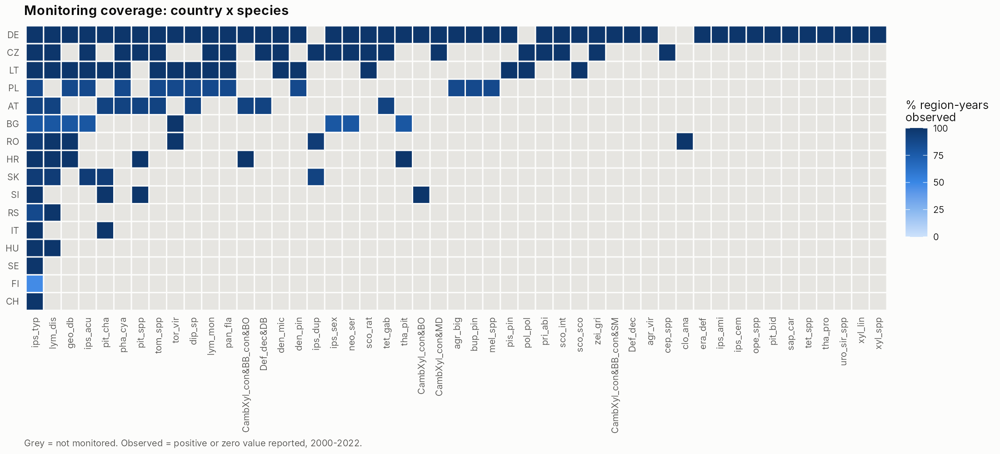

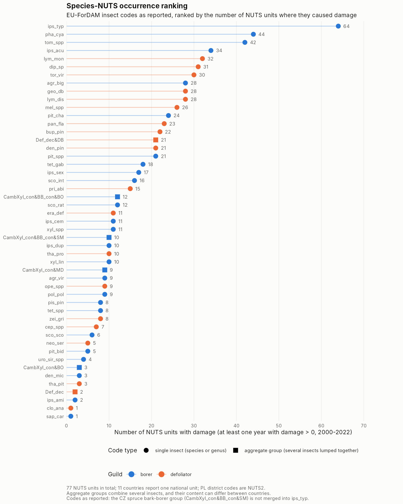

Every insect code as reported, ranked by the number of NUTS units where it caused damage (at least one year with damage > 0). Colour = guild; squares mark aggregate groups (several insects lumped together, content can differ between countries), circles single insects (species or genus). Codes are kept as reported, so the CZ spruce bark-borer group is its own aggregate code here rather than part of *I. typographus*. Table: `outputs/tables/species_nuts_occurrence_ranking_v2.csv`.

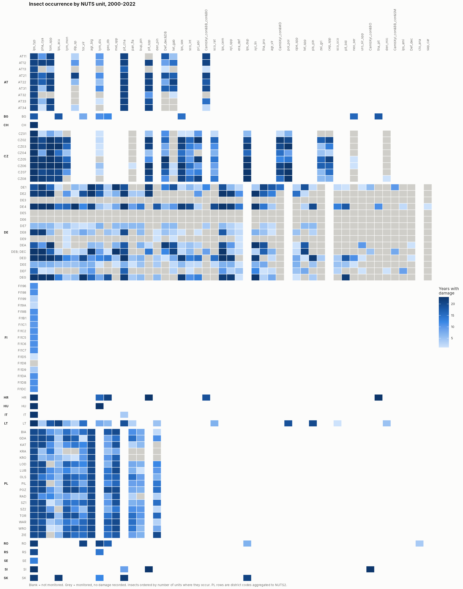

Full occurrence tables (ranking of insects by regions, ranking within each region, region × insect matrix): `outputs/tables/species_nuts_occurrence_ranking.xlsx`.

## Correlation metrics: how much does each insect tell us about the others?

For every pair of insect codes, using region-years where both are recorded:

- **Same year:** do they have bad years together? (r of within-series standardised damage)
- **Beyond shared bad years:** still linked after removing each insect's Europe-wide yearly signal? Separates a real link from both reacting to the same drought year.
- **Lead effect:** does insect A's bad year predict insect B's *next* year beyond B's own previous year? (partial correlation, Granger-type) Tests whether one disturbance sets up another.
- **Co-occurrence:** do they tend to have any damage in the same region-year?

**Uncertainty.** 95% ranges come from resampling whole regions 999 times (block bootstrap), which respects the dependence between years within a region. Ranges are given only when ≥ 5 regions contribute (`r sum(!is.na(cm$same_year_lo))` pairs). A link counts only if its range excludes zero.

```{r cm-verdicts}
cm |> count(link, name = "pairs") |>
  mutate(link = factor(link, c("strong, beyond shared bad years", "strong, mostly shared bad years",
                               "weak but real", "no clear link", "not enough data"))) |> arrange(link)
```

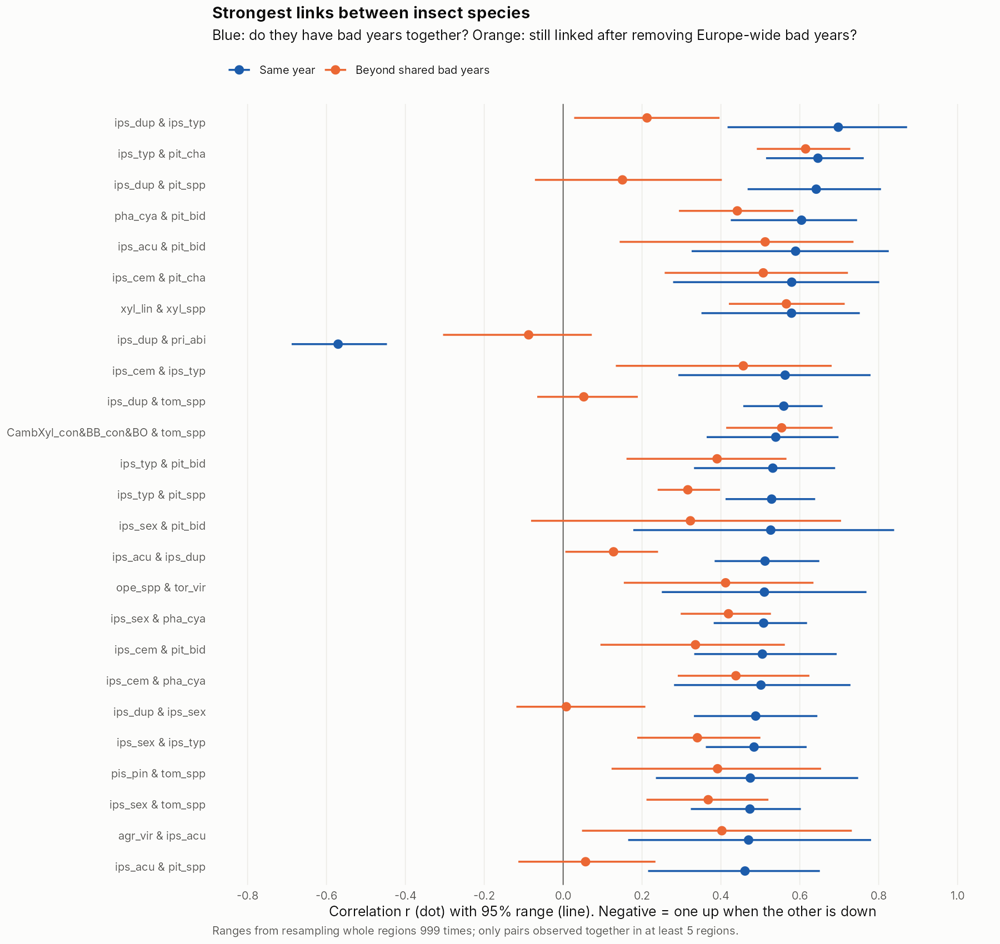

Where the two dots of a pair are close, the link holds beyond shared bad years (a local connection); where the orange dot is much lower, the pair mainly shares the same bad years.

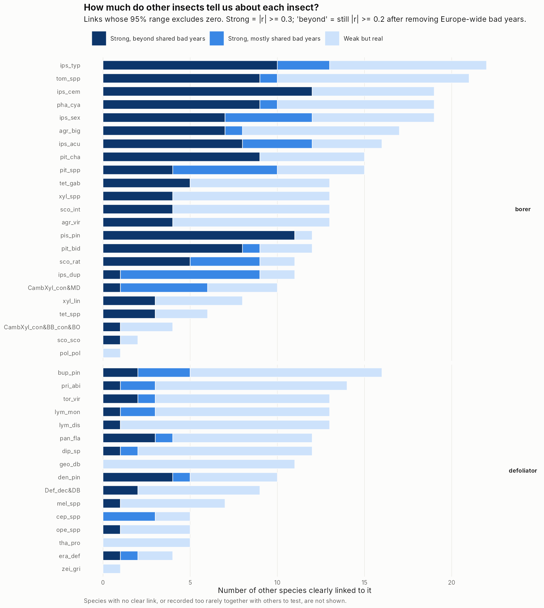

The most connected insects are `r paste0("*", cms_tot$species[1:5], "* (", cms_tot$total[1:5], ")", collapse = ", ")`: these carry the most information about other insects.

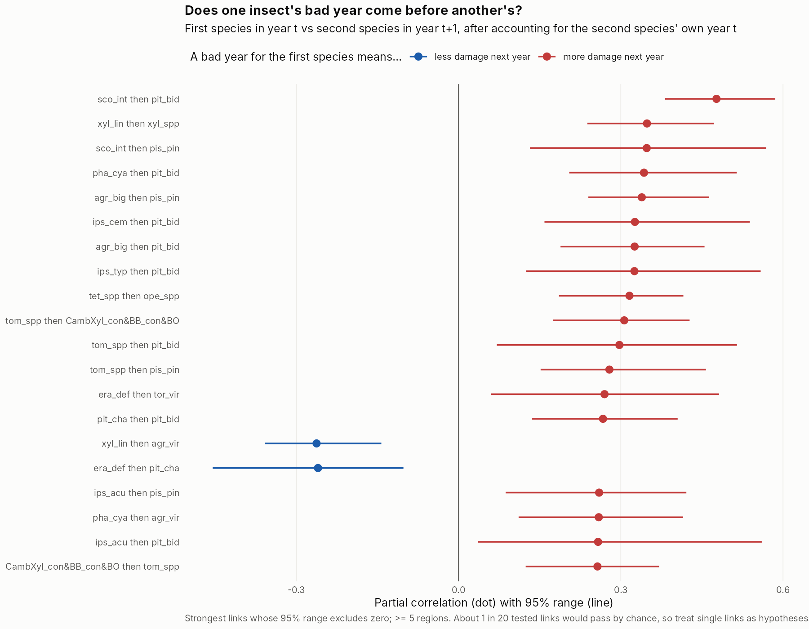

**Lead effects:** `r sum(lags$sure)` of `r sum(!is.na(lags$lo))` testable ordered pairs pass, against about `r round(0.05 * sum(!is.na(lags$lo)))` expected by chance. Sequential effects exist in the data, but any single link may be a chance result; they are candidates for the "one disturbance predisposes the next" mechanism once storm and drought records are added.

**Co-occurrence** (any damage in the same region-year) has median r = `r f2(median(cm$co_occur, na.rm = TRUE))` and tracks the same-year link only partly (r = `r f2(cor(cm$co_occur, cm$same_year, use = "complete"))`): *whether* damage occurs and *how much* behave differently, which supports a two-part model.

### Guild structure

```{r perm}
perm |> transmute(grouping, version, `mean r within group` = f2(mean_r_within),
                  `mean r between groups` = f2(mean_r_between), `p (permutation)` = signif(p_perm_one_sided, 2))
```

Insects of the same feeding guild (borer vs defoliator) correlate more strongly than insects of different guilds, also after removing Europe-wide bad years; host type alone (conifer vs broadleaf) does not separate them. Guild labels are provisional (from the file's indicator columns).

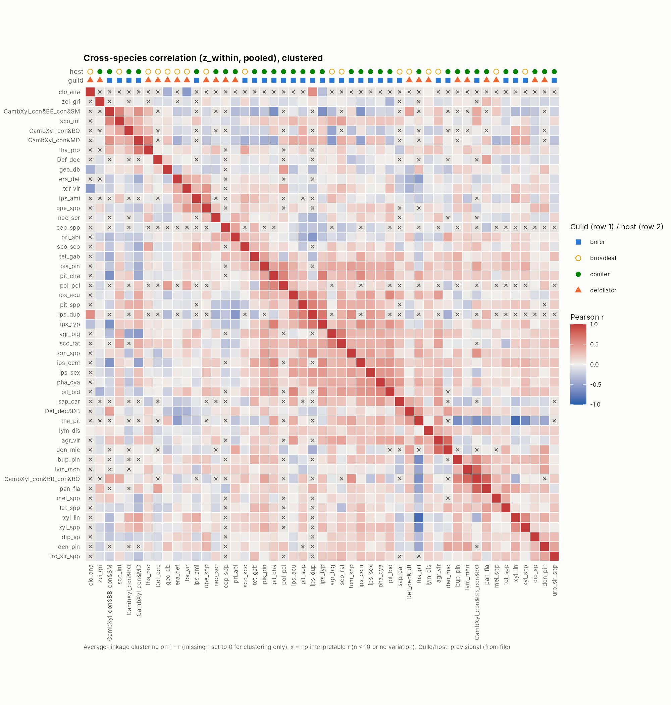

### Does a link hold in other countries?

Gaps are whole countries that never monitored an insect, so a link is only useful if it holds across countries. **Consistent** = ≥ 2 countries with ≥ 10 shared region-years, same sign everywhere, SD of country r ≤ 0.2, and no sign flip when any one country is dropped.

```{r transfer}
ts |> count(version, transferability) |> tidyr::pivot_wider(names_from = transferability, values_from = n)
```

```{r consistent}
tz |> filter(transferability == "consistent") |> arrange(desc(abs(r_pooled))) |> slice_head(n = 12) |>
  transmute(pair = paste(species_a, "&", species_b), r = f2(r_pooled), countries = countries_n10, `SD of country r` = f2(r_sd))
```

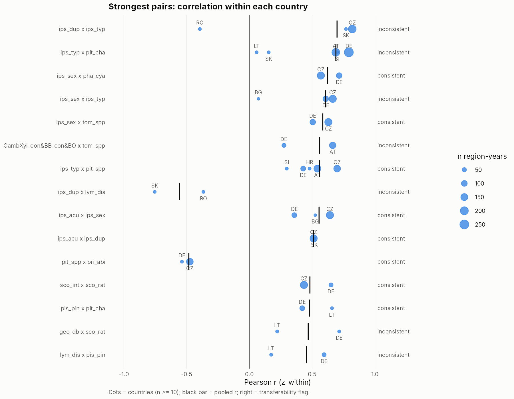

*I. typographus*, recorded almost everywhere, has links that hold across countries with *Pityokteines*, *Phaenops* and *I. acuminatus*; its strongest partner, *P. chalcographus*, is strong in Germany and Austria but not elsewhere.

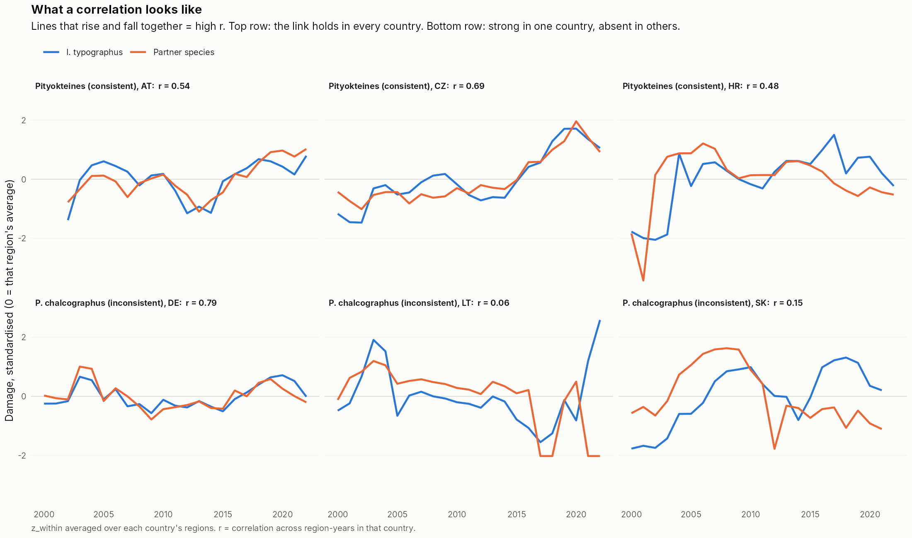

### Sensitivity: the paper's series filter

With the ≥ 6 damage-year filter of Hlásny et al. (2025), pooled same-year correlations correlate `r { j <- inner_join(pw |> filter(version == "z_within") |> select(species_a, species_b, r = r_pearson), pw6 |> filter(version == "z_within") |> select(species_a, species_b, r6 = r_pearson), by = c("species_a", "species_b")); f2(cor(j$r, j$r6, use = "complete")) }` with the main results; the filter mainly removes sparse series and many pairs with them.

## Comparison with Hlásny et al. (2025), Table 6

Summing our data over all regions per insect and year and correlating the Europe-wide totals reproduces Table 6 of the paper:

```{r t6}
t6 |> arrange(desc(paper_value)) |>
  transmute(pair = paste(species_a, "&", species_b), `paper (Table 6)` = f2(paper_value),
            `our r²` = f2(r2_ours), `our r` = f2(r_ours), `our p` = signif(p_ours, 2))
```

- The paper's values equal our **r²** (mean difference `r formatC(mean(t6$abs_diff_paper_vs_r2), format = "f", digits = 3)`), not our r (mean difference `r f2(mean(t6$abs_diff_paper_vs_r))`), so Table 6 appears to report squared correlations — which explains the paper's note that all correlations were non-negative.
- `r sum(t6$r_ours < 0)` of 36 pairs are actually negative; none reaches the paper's significance threshold (p < 0.001), so its highlighted results are unaffected. Worth raising with Prof. Hlásny.
- Europe-wide correlations (e.g. *I. typographus* & *Phaenops* r = `r f2(t6$r_ours[t6$species_a=="ips_typ" & t6$species_b=="pha_cya"])`) are much stronger than regional ones, because continental totals are dominated by a few big years and by Germany.

## Latent factor model (prototype)

**Aim (PhD objective 1):** fill gaps using all records at once, assuming that damage across insects is driven by a few shared hidden factors.

**Model.** A table of region-years × insects (`log(damage + 1)`, zeros included, empty where not monitored). Each value = insect level + overall damage intensity of that region-year + Σ (region-year score on hidden factor k × the insect's sensitivity to factor k). Fitted by alternating ridge regression on recorded cells only (`R/lfm.R`).

**Test.** Whole country × insect blocks were hidden (e.g. all Polish *Phaenops* records) and predicted from everything else, mimicking real gaps: 10-fold cross-validation over `r nrow(rd("lfm_blocks"))` blocks (only insects recorded in ≥ 2 countries can be tested). Baselines: insect average; insect × year average (Europe-wide bad years); best single helper insect.

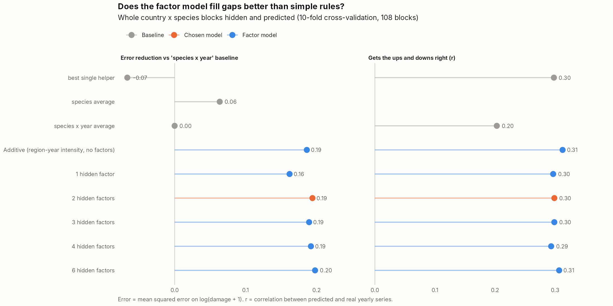

```{r lfm-scores}
lsc |> left_join(lgrid, by = "model") |> filter(is.na(K) | lambda %in% c(50, 100) | K == 0) |> arrange(rmse) |>
  transmute(model, `RMSE (log scale)` = f2(rmse), `error reduction vs insect×year` = f2(skill_vs_year_baseline),
            `ups-and-downs r` = f2(dynamics_r))
```

```{r lfm-split}
d <- lcv |> filter(model == lbest$model, !is.na(predicted)) |>
  group_by(nuts_id, species) |> mutate(e = predicted - observed, lvl = mean(e)) |> ungroup()
level_share <- mean(d$lvl^2) / mean(d$e^2)
worst <- d |> distinct(country, nuts_id, species, lvl) |> group_by(country) |>
  summarise(err = mean(abs(lvl)), .groups = "drop") |> arrange(desc(err))
```

- Chosen model: **`r lbest$model`** (simplest within 0.5% of the best). It reduces error by **`r pct(100 * lbest$skill_vs_year_baseline)`** versus insect × year averages; the best single helper reduces it by `r pct(100 * skill("Baseline: best single helper"))`. Using all insects together works better than using one.
- **Most of the gain comes from the region-year intensity term:** the purely additive model (no hidden factors) is almost as good (`r pct(100 * skill("Factor model: K=0, lambda=20"))`). With the current data, few insects are recorded together outside Germany, so insect-specific factors are hard to learn and transfer.
- **Errors are still large** (RMSE ≈ `r f2(lbest$rmse)` on the log scale). About `r pct(100 * level_share)` of the error is the *level* of damage, largest for `r paste(head(worst$country, 4), collapse = ", ")`. This one-part model has no forest area, so it cannot tell a small region from a whole country (host area is added in the two-part model below). The rest is year-to-year variation.

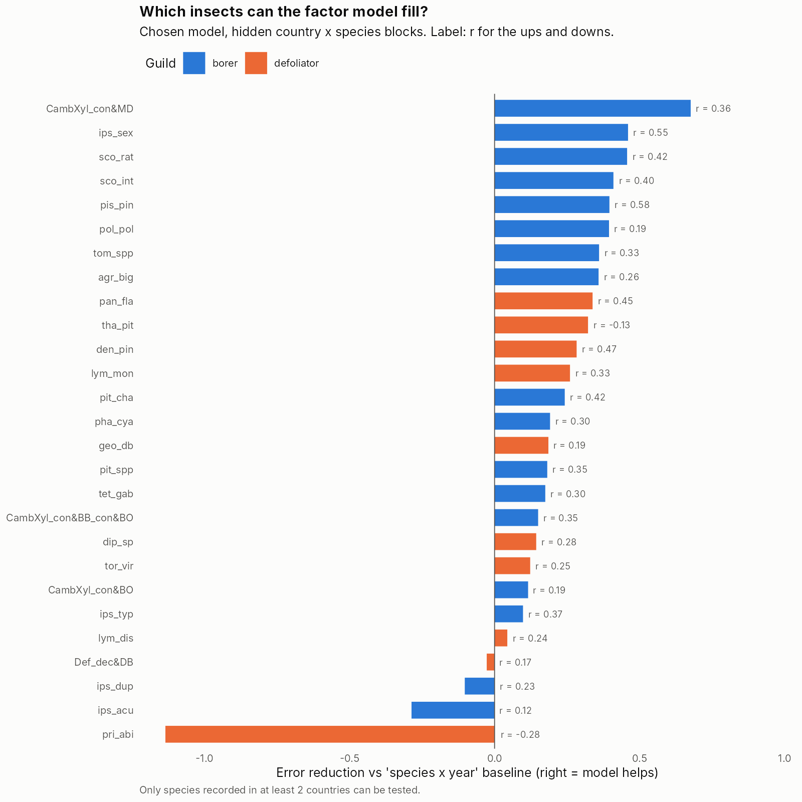

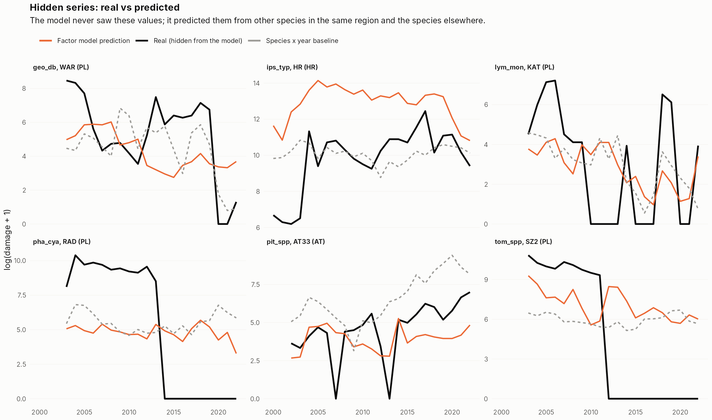

The examples are the *typical* (median) hidden series for six insects, not the best ones.

### What the model learned

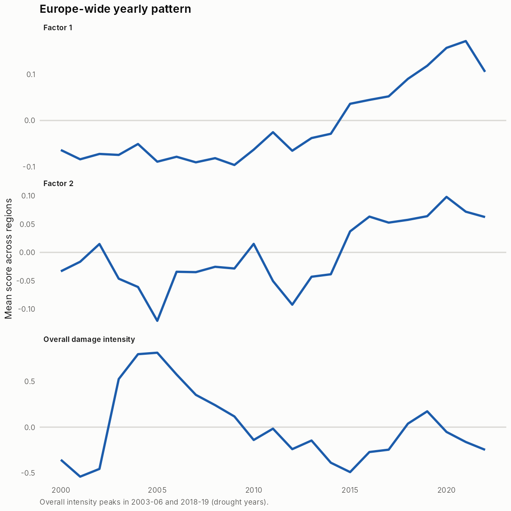

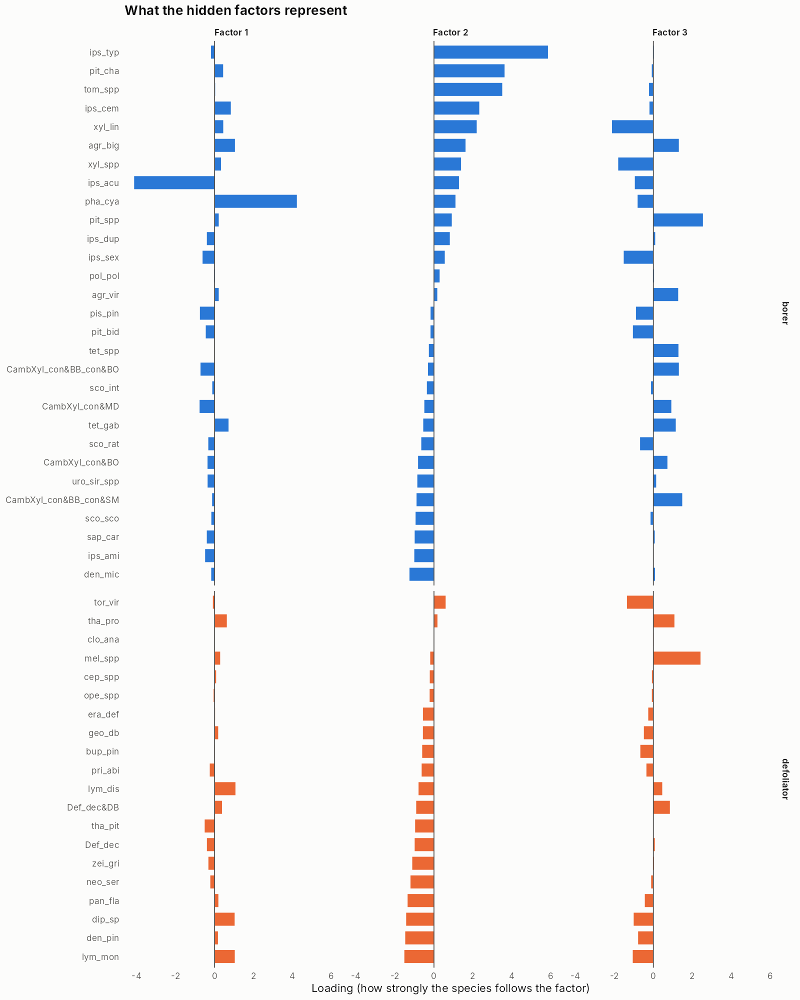

- **Overall damage intensity** peaks in **2003–06**, after the 2003 drought.
- **Factor 2** separates bark beetles (*I. typographus*, *P. chalcographus*, *Tomicus*; positive) from defoliators (negative) and is highest in 2019–21, during the large bark-beetle wave — the "divergent trends" of Hlásny et al. (2025).
- **Factors 1 and 3** have no clear ecological interpretation yet (factor 1 mainly contrasts *Phaenops* with *I. acuminatus*). They may reflect regional reporting differences; covariates (host trees, climate) should help separate ecology from reporting.

### Next steps for the model

1. **Covariates:** host-tree area (done, below) and VPD per region (still needed).
2. **Two-part model:** "any damage?" and "how much?" separately; most recorded values are zeros (`r pct(100 * mean(tr$damage == 0))`).
3. **Uncertainty:** a Bayesian version giving each filled value a range.
4. **Abiotic damage** (storm, drought, fire) when available, likely the strongest shared factors.
5. Gap-filled values (prototype, not for totals yet): `data/processed/lfm_gap_filled_PROTOTYPE.csv`.

## Two-part gap-filling and a first harmonised dataset (preliminary)

```{r hurdle-setup}
hs <- rd("h_part_scores"); hc <- rd("h_cmp")$summary; hconf <- rd("h_conf"); hf <- rd("h_filled")
b1 <- rd("h_best1"); b2 <- rd("h_best2"); ht <- rd("h_totals")
hh <- rd("hh_cmp")$summary; hst <- rd("host_status")
p1base <- hs$auc[hs$model == "P1 baseline: insect rate"]
p2base <- hs$rmse_log[hs$model == "P2 baseline: insect x year mean"]
ityp_obs <- sum(ht$observed[ht$species == "ips_typ"])
```

**Why two parts.** `r pct(100 * mean(tr$damage == 0))` of recorded values are zeros, and almost all fillable gaps (`r format(sum(hf$gap_type == "country never monitored this insect", na.rm = TRUE), big.mark = ",")` of `r format(sum(hf$value_type == "filled"), big.mark = ",")` cells) are countries that never monitored the insect, so the first question for a gap is whether the insect occurs at all. The model therefore answers two questions:

1. **Any damage?** A logistic factor model on all recorded values (damage = 1, recorded zero = 0) gives a probability.
2. **How much, if damaged?** The linear factor model fitted to damage values only.

Filled value = probability of any damage × expected amount if damaged.

**Test** (same hidden country × insect blocks as above):

- *Any damage?* — `r b1$model`: AUC `r f2(b1$auc)` (insect-rate baseline `r f2(p1base)`). Adding hidden factors does not help this part; the region-year intensity carries the information.
- *How much?* — `r b2$model`: RMSE `r f2(b2$rmse_log)` on the log scale, versus `r f2(p2base)` for insect × year means.

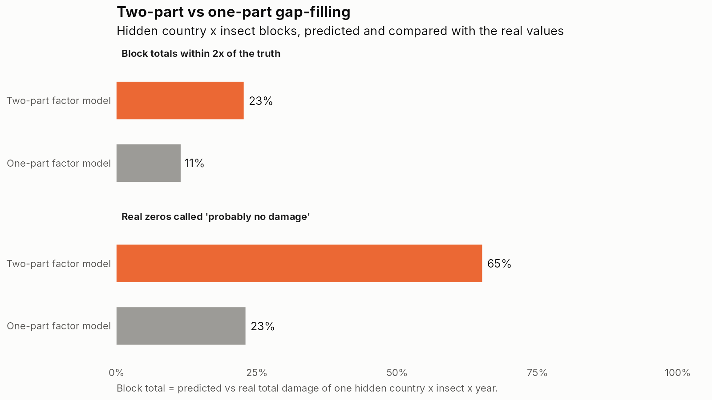

```{r hurdle-compare}
hh |> transmute(model, `real zeros called zero` = pct(100 * zeros_called_zero), `AUC any damage` = f2(auc_any),
                `typical error of block totals (× off)` = f2(exp(median_abs_log_ratio_totals)),
                `block totals within 2×` = pct(100 * share_totals_within_2x))
```

The two-part model is much better at what Europe-wide totals need: it recognises real zeros (`r pct(100 * hh$zeros_called_zero[2])` vs `r pct(100 * hh$zeros_called_zero[1])`) and gets hidden block totals within 2× twice as often.

### Adding host trees

Host information enters in three ways: (1) cells with the host tree absent are set to zero; (2) "any damage?" also sees the log host area, with one slope per insect; (3) "how much?" models damage per 1000 ha of host forest and multiplies back by the region's host area (where area is unknown, the plain amount is used).

```{r host-status}
hst |> count(host_status, name = "region × insect pairs") |> arrange(desc(`region × insect pairs`))
```

Host trees help the amounts, not the presence: typical block-total error drops from `r f2(exp(hh$median_abs_log_ratio_totals[2]))`× to `r f2(exp(hh$median_abs_log_ratio_totals[3]))`× off, and block totals within 2× rise from `r pct(100 * hh$share_totals_within_2x[2])` to `r pct(100 * hh$share_totals_within_2x[3])`. Separating damage from no damage does not improve (AUC `r f2(hh$auc_any[2])` vs `r f2(hh$auc_any[3])`), because spruce, pine and oak grow in almost every region, so "host present" rarely rules anything out. Host absence removes `r format(sum(hf$value_type == "zero: host tree absent"), big.mark = ",")` cells, mostly oak insects in Finland.

**Main limitation.** Within an insect, the model often cannot tell *which* never-monitored places have damage: only `r sum(hconf$confidence == "works")` insects pass the confidence rule (beats the insect × year baseline and AUC ≥ 0.7), `r sum(hconf$confidence == "weak")` are weak, and `r sum(hconf$confidence == "untested")` cannot be tested because they are recorded in one country only. Host trees tell where an insect *could* be, not whether it is there; the insect's known distribution range (e.g. EPPO / literature) is the missing information.

### The harmonised dataset

Every region-year-insect cell is labelled observed, zero because the host tree is absent, filled (with confidence, host status, and an 80% range for the amount if damaged), or not fillable (nothing at all recorded in that region-year). File: `data/processed/eufordam_harmonised_PRELIMINARY.csv` (not shared).

```{r hurdle-cells}
hf |> mutate(status = case_when(value_type == "filled" ~ paste0("filled (", confidence, ")"), TRUE ~ value_type)) |>
  count(status, name = "cells") |> mutate(share = pct(100 * cells / sum(cells))) |> arrange(desc(cells))
```

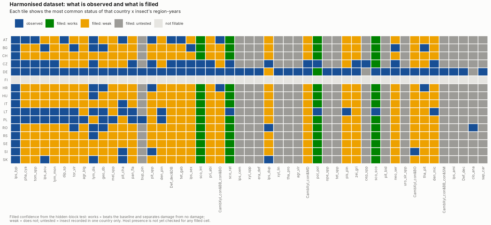

### Europe-wide totals: not yet trustworthy

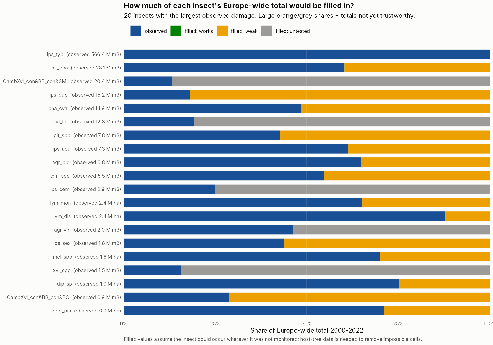

For *I. typographus*, recorded almost everywhere, the observed total (`r formatC(ityp_obs / 1e6, format = "f", digits = 0)` million m³, 2000–2022) is close to the 587 million m³ in Hlásny et al. (2025, Table 2), and filling adds almost nothing. For most other insects, filled values would make up half or more of the total, sometimes several times the observed damage, because the model spreads each insect into every country with its host tree that never monitored it. Host trees do not fix this: the host is present almost everywhere. Group codes reported by one country only (e.g. the CZ group `CambXyl_con&BB_con&SM`, filled at about 12× its observed total) should not be filled into other countries at all. These totals should not be used yet.

## Harmonising by gap type and agent group

```{r groups-setup}
gt <- rd("gap_tab"); bcs <- rd("bc_scores"); gcmp <- rd("g_cmp")$summary; gconf <- rd("g_conf")
gtot <- rd("g_totals"); gh <- rd("g_harm"); grp <- rd("groups")
gshare <- function(level_, gap_) gt$share[gt$level == level_ & gt$gap == gap_]
```

**Most insect-level "gaps" are not missing records.** Splitting every empty cell by *why* it is empty:

```{r gap-types}
gt |> select(level, gap, cells) |> tidyr::pivot_wider(names_from = level, values_from = cells, values_fill = 0) |>
  arrange(desc(insect))
```

At insect level, `r pct(100 * gshare("insect", "never reported by this country"))` of cells are insects a country **never reports**: a difference in reporting schemes, not a gap in a record. Inside the years a country reports an insect, the record is essentially complete. The only real missing years are **before a series starts** (AT from 2002, PL from 2003, FI from 2012). The earlier models filled the first kind, and could not fill the second.

**Agent groups.** Insects are combined into `r n_distinct(grp$group)` provisional groups (guild × host tree, e.g. "borers on spruce"). The group value is the sum of the recorded insects. At group level the share of never-reported cells falls to `r pct(100 * gshare("agent group", "never reported by this country"))`, and `r pct(100 * gshare("agent group", "recorded"))` of cells are recorded (`r pct(100 * gshare("insect", "recorded"))` at insect level).

**Treatment by gap type:**

| Gap | Treatment |
|---|---|
| Host absent | zero |
| Before the series starts | back-cast: the series' own level in its first 5 recorded years |
| Never reported by this country | **zero** ("no problem there", decided Oct 2026). The model's guess is kept only as a sensitivity check |
| Missing year inside a reported series | two-part model with host trees (1 cell at group level) |
| Nothing recorded in the region-year | left empty |

**Back-casting test.** For countries recorded from 2000, we hid the first 2, 3 or 12 years of the whole country (mimicking AT, PL and FI) and predicted them.

```{r backcast}
bcs |> transmute(level, `years hidden` = n_hide, series, `RMSE carry back` = f2(rmse_carry_back),
                 `RMSE + change in other countries` = f2(rmse_backcast))
```

Adding the year-to-year change seen in other countries makes the back-cast *worse*, so the simpler carry-back is used. Errors are large (RMSE ≈ 2 on the log scale, i.e. often several times off for a single year). Back-cast years give a typical level, not that year's outbreak.

**Presence at group level** is easier to predict than at insect level (hidden-block AUC `r f2(gcmp$auc_any[3])` with host trees, vs `r f2(hh$auc_any[3])` for insects). The model passes the confidence rule for `r paste(gconf$species[gconf$confidence == "works"], collapse = ", ")`, the main groups. It is weak for the rest; for borers on oak the AUC is below 0.5.

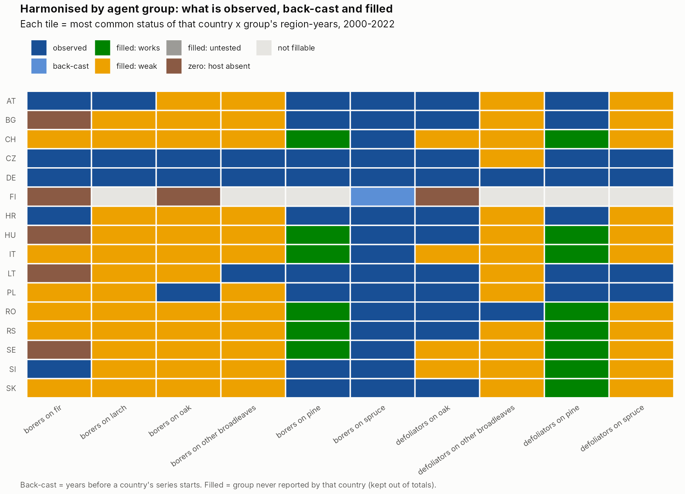

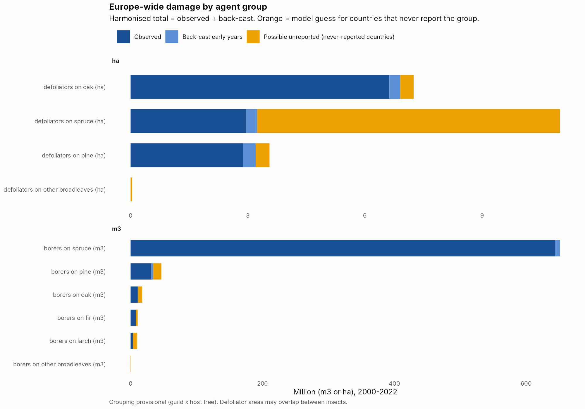

```{r group-cells}
gh |> count(value_type, name = "cells") |> mutate(share = pct(100 * cells / sum(cells))) |> arrange(desc(cells))
```

**Harmonised Europe-wide totals** (observed + back-cast, never-reported = 0) rest almost entirely on observed data. Borers on spruce: `r formatC(sum(gtot$harmonised_total[gtot$group == "borers on spruce"]) / 1e6, format = "f", digits = 0)` million m³, 2000–2022, of which `r pct(100 * sum(gtot$back_cast[gtot$group == "borers on spruce"]) / sum(gtot$harmonised_total[gtot$group == "borers on spruce"]))` back-cast.

**Sensitivity of the "never reported = 0" choice.** The orange bars show what the model would add if never-reported meant "unknown" instead. The choice hardly matters for borers on spruce (every country reports them), or for pine and oak defoliators. It matters a lot for **defoliators on spruce** and **borers on larch**, where the model's guess is larger than everything observed. Those two group totals depend on the assumption and should be presented with that caveat. File: `data/processed/eufordam_harmonised_agent_groups_PRELIMINARY.csv` (not shared).

**To confirm with Prof. Hlásny:** the grouping (`outputs/tables/agent_groups_PROVISIONAL.csv`), and the "never reported = no damage" rule.

## Open questions for Prof. Hlásny

1. **Table 6:** are the values r² rather than r?
2. **Dataset version:** our file has `r counts$n_regions` regions and `r counts$n_species` codes; the paper reports 82 spatial units and 50 species (Zenodo 10.5281/zenodo.15863174).
3. **Appendix B:** conversion factors, and which Polish species were split from groups by fixed proportions.
4. **Host-tree table:** does "-" mean the tree is absent or not reported? Are BG and LT volumes in 1000 m³? Is there area for larch, birch and poplar?
5. **VPD per region** as used in the paper.
6. **CZ values in multiples of 1/7:** known cause?
7. **Other group codes:** should any besides the CZ spruce group be mapped to a dominant species?
8. **Agent groups:** is the guild × host grouping right, and does he agree that a group a country never reports means no damage there (our current rule)?

## Files

- Correlation metrics: `outputs/tables/correlation_metrics_all_pairs.csv`, `correlation_metrics_by_species.csv`, `correlation_metrics_lagged.csv`
- Transferability: `per_country_correlations.csv`, `leave_one_country_out.csv`, `transferability_summary.csv`
- Gap types and groups: `gap_types_insect_vs_group.csv`, `agent_groups_PROVISIONAL.csv`, `backcast_test_scores.csv`, `group_gapfill_models_compared.csv`, `group_confidence.csv`, `europe_totals_by_agent_group_PRELIMINARY.csv`
- Host trees: `host_area_by_region.csv`, `host_status_region_insect.csv`, `gapfill_models_compared_with_hosts.csv`
- Two-part model: `hurdle_cv_part_scores.csv`, `hurdle_vs_one_part.csv`, `hurdle_confidence_by_species.csv`, `europe_totals_observed_plus_filled_PRELIMINARY.csv`
- Factor model: `lfm_cv_scores_by_model.csv`, `lfm_cv_scores_by_species.csv`, `lfm_factor_loadings.csv`
- Occurrence: `species_nuts_occurrence_ranking.xlsx`; coverage: `coverage_*.csv`; Table 6 replication: `paper_table6_replication.csv`
- Figures: `outputs/figures/`
